# 🛡️ BukSU CMS-V2 Comprehensive Security Vulnerability & Architectural Consistency Audit Report
**Target Executor:** Gemini 3.8 (`system-implementor` / ASDLC v2.0 Orchestrator)  
**Target Platform:** BukSU Capstone Management System V2 (`CMS-V2`)  
**Audit Standard:** OWASP API Security Top 10 (2023), ASDLC v2.0, BukSU Institutional Role & Workflow Boundaries (`AGENTS.md` / `GEMINI.md`)  
**Audit Date:** 2026-10-21  

---

> [!IMPORTANT]
> **Execution Instructions for Gemini 3.8:**
> 1. Follow the **ASDLC v2.0 8-Stage Execution Lifecycle** and **Pile B Hard Survival Rules** in [`AGENTS.md`](file:///c:/Users/patri/dev/CMS-V2/AGENTS.md) and [`GEMINI.md`](file:///c:/Users/patri/dev/CMS-V2/GEMINI.md).
> 2. Apply all code modifications using **surgical CST diffs** (`edit_file`) — never rewrite entire files.
> 3. Execute the **Fast-Path Targeted Verification Command** listed under each wave before moving to the next wave.
> 4. For Wave 3 & Wave 4 UI changes in `client/src/`, execute the mandatory **4-Viewport Playwright Visual Feedback Loop** (`1440×900` Desktop & `390×844` Mobile in Light & Dark modes) before final sign-off.

---

## 1. Executive Summary & Master Findings Matrix

A full-stack static and cross-layer contract audit across `server/`, `client/src/`, `shared/`, and `plagiarism_engine/` uncovered **26 verified findings**:
- **4 CRITICAL** vulnerabilities (cross-project manuscript/annotation IDOR, arbitrary storage key read via avatar proxy, student/unassigned-faculty ADM & phase-routing tampering, and Course Instructor inclusion in committee comboboxes).
- **12 HIGH** vulnerabilities & workflow inconsistencies (unauthenticated password reset takeover window, inverted `!project.isArchived` access checks leaking certificates/evaluations, ADM Secretary Compliance Gate bypasses, consolidated `ROLES.FACULTY` permission breaks, non-leader locked-team section hijacking, NoSQL operator / ReDoS injection, stored `javascript:` URL execution, and `githubUrl` vs `githubLink` contract drift).
- **10 MEDIUM** findings (silent `catch {}` runtime `ReferenceError`s hiding broken defense notifications and cache eviction, ZIP/DOCX upload stream validation & filesystem fallback bypass, committee mutual-exclusion gaps, `studentId` uniqueness & `.lean()` serialization drift, HST self-plagiarism matching, legacy viewer bypasses, and hardcoded dark hex classes in UI primitives).

| ID | Severity | Layer | Category | Title | Primary File(s) & Line Range(s) |
| :--- | :--- | :--- | :--- | :--- | :--- |
| **VULN-01** | 🔴 **CRITICAL** | Server | BOLA / IDOR (CWE-639) | Cross-Project Manuscript & Private Annotation Disclosure via Unvalidated `compareWithId` | [`submissionRevisionDiff.service.js:L106-L150`](file:///c:/Users/patri/dev/CMS-V2/server/modules/submissions/services/submissionRevisionDiff.service.js#L106-L150) |
| **VULN-02** | 🔴 **CRITICAL** | Server | BOLA / Workflow Gate (CWE-285) | Students & Unassigned Faculty Can Wipe/Seed ADM Rows, Mutate ADM Metadata & Force Capstone Course Routing | [`project.controller.js:L918-L969`](file:///c:/Users/patri/dev/CMS-V2/server/modules/projects/project.controller.js#L918-L969), [`L1292-L1349`](file:///c:/Users/patri/dev/CMS-V2/server/modules/projects/project.controller.js#L1292-L1349), [`L1406-L1459`](file:///c:/Users/patri/dev/CMS-V2/server/modules/projects/project.controller.js#L1406-L1459), [`L1823-L1910`](file:///c:/Users/patri/dev/CMS-V2/server/modules/projects/project.controller.js#L1823-L1910) |
| **VULN-03** | 🔴 **CRITICAL** | Server | Arbitrary Storage Read (CWE-639) | Arbitrary S3 / Filesystem Storage Key Read via Unvalidated `profilePicture` + Public `/api/users/:userId/avatar` Proxy | [`user.validation.js:L72-L77`](file:///c:/Users/patri/dev/CMS-V2/server/modules/users/user.validation.js#L72-L77), [`user.service.js:L100-L117`](file:///c:/Users/patri/dev/CMS-V2/server/modules/users/user.service.js#L100-L117), [`L405-L413`](file:///c:/Users/patri/dev/CMS-V2/server/modules/users/user.service.js#L405-L413) |
| **VULN-04** | 🔴 **CRITICAL** | Client | Institutional Rule #2 Violation | Course Instructors (`ROLES.INSTRUCTOR`) Included in Committee Assignment Comboboxes & Invalid Comma-Joined Role Query | [`TeamCommitteeAssignmentsView.jsx:L86-L110`](file:///c:/Users/patri/dev/CMS-V2/client/src/components/users/TeamCommitteeAssignmentsView.jsx#L86-L110) |
| **VULN-05** | 🟠 **HIGH** | Server | Auth Bypass (CWE-640) | Unauthenticated Password Reset Takeover During 10-Minute Verified OTP Window (Missing OTP/Token Binding on `/reset-password`) | [`auth.service.js:L126-L134`](file:///c:/Users/patri/dev/CMS-V2/server/modules/auth/auth.service.js#L126-L134), [`L299-L345`](file:///c:/Users/patri/dev/CMS-V2/server/modules/auth/auth.service.js#L299-L345), [`auth.validation.js:L105-L120`](file:///c:/Users/patri/dev/CMS-V2/server/modules/auth/auth.validation.js#L105-L120) |
| **VULN-06** | 🟠 **HIGH** | Server | BOLA / IDOR (CWE-639) | Inverted `!project.isArchived` Check Leaks Signed Completion Certificates, Approval Sheets & Private Defense Evaluations to All Students | [`projectArchive.service.js:L1055-L1144`](file:///c:/Users/patri/dev/CMS-V2/server/modules/projects/services/projectArchive.service.js#L1055-L1144), [`evaluation.service.js:L505-L628`](file:///c:/Users/patri/dev/CMS-V2/server/modules/evaluations/evaluation.service.js#L505-L628), [`L672-L788`](file:///c:/Users/patri/dev/CMS-V2/server/modules/evaluations/evaluation.service.js#L672-L788) |
| **VULN-07** | 🟠 **HIGH** | Server | BOLA / IDOR (CWE-639) | Missing Authorization on `addTitleComment`, `getDefenseSchedule`, and `getTeamManuscriptTemplate` | [`projectTitle.service.js:L765-L859`](file:///c:/Users/patri/dev/CMS-V2/server/modules/projects/services/projectTitle.service.js#L765-L859), [`projectDefense.service.js:L340-L362`](file:///c:/Users/patri/dev/CMS-V2/server/modules/projects/services/projectDefense.service.js#L340-L362), [`teamTemplate.service.js:L20-L118`](file:///c:/Users/patri/dev/CMS-V2/server/modules/teams/services/teamTemplate.service.js#L20-L118) |
| **VULN-08** | 🟠 **HIGH** | Server | BOLA / IDOR (CWE-639) | Inline Submission Comments Allow Cross-Team Student Writes on Archived Projects & Unassigned Faculty Mutations | [`submission.controller.js:L498-L708`](file:///c:/Users/patri/dev/CMS-V2/server/modules/submissions/submission.controller.js#L498-L708) |
| **VULN-09** | 🟠 **HIGH** | Server | BOLA / Workflow Gate (CWE-285) | Unassigned Faculty Can View/Auto-Create Defense Minutes & Any Viewer Can Overwrite Plagiarism Reports via `/archive-scan` | [`defenseMinutes.service.js:L105-L169`](file:///c:/Users/patri/dev/CMS-V2/server/modules/submissions/defenseMinutes.service.js#L105-L169), [`plagiarism.controller.js:L470-L581`](file:///c:/Users/patri/dev/CMS-V2/server/modules/plagiarism/plagiarism.controller.js#L470-L581), [`submission.routes.js:L537-L544`](file:///c:/Users/patri/dev/CMS-V2/server/modules/submissions/submission.routes.js#L537-L544) |
| **VULN-10** | 🟠 **HIGH** | Server | Institutional Rule #4 Bypass | `signADMItem` Bypasses Secretary Compliance Verification Gate (`secretary.endorsed`) & Permits Global `facultyRole === 'chair'` Cross-Project Signing | [`project.controller.js:L1967-L2027`](file:///c:/Users/patri/dev/CMS-V2/server/modules/projects/project.controller.js#L1967-L2027), [`authorize.js:L365-L373`](file:///c:/Users/patri/dev/CMS-V2/server/middleware/authorize.js#L365-L373) |
| **VULN-11** | 🟠 **HIGH** | Server | Role Consolidation Drift | Consolidated `ROLES.FACULTY` Breaks Tier-1 Adviser ADM Signing, `getProjectPermissions` Instructor/Secretary Resolution & `document.service.js` | [`authorize.js:L299`](file:///c:/Users/patri/dev/CMS-V2/server/middleware/authorize.js#L299), [`L437-L512`](file:///c:/Users/patri/dev/CMS-V2/server/middleware/authorize.js#L437-L512), [`project.controller.js:L1532`](file:///c:/Users/patri/dev/CMS-V2/server/modules/projects/project.controller.js#L1532), [`document.service.js:L240-L288`](file:///c:/Users/patri/dev/CMS-V2/server/modules/documents/document.service.js#L240-L288) |
| **VULN-12** | 🟠 **HIGH** | Server | BOLA / State Hijack | Non-Leader Student in Locked Team Can Overwrite Team & Project `sectionId` / `academicYear` / `courseId` via `PATCH /api/users/me` | [`user.service.js:L138-L209`](file:///c:/Users/patri/dev/CMS-V2/server/modules/users/user.service.js#L138-L209) |
| **VULN-13** | 🟠 **HIGH** | Server | NoSQLi & ReDoS (CWE-943 / CWE-1333) | Missing Zod Validation Enables NoSQL Operator Injection on `manuscript-template` / `manuscript` & Unescaped `$regex` in `team.service.js` | [`team.routes.js:L109-L113`](file:///c:/Users/patri/dev/CMS-V2/server/modules/teams/team.routes.js#L109-L113), [`teamTemplate.service.js:L154`](file:///c:/Users/patri/dev/CMS-V2/server/modules/teams/services/teamTemplate.service.js#L154), [`projectArchive.service.js:L2478`](file:///c:/Users/patri/dev/CMS-V2/server/modules/projects/services/projectArchive.service.js#L2478), [`team.service.js:L1098`](file:///c:/Users/patri/dev/CMS-V2/server/modules/teams/team.service.js#L1098), [`L1789`](file:///c:/Users/patri/dev/CMS-V2/server/modules/teams/team.service.js#L1789) |
| **VULN-14** | 🟠 **HIGH** | Full-Stack | Stored XSS / Unsafe URL Scheme (CWE-79) | `javascript:` & `data:` URLs Accepted in Prototype Links, Gantt URL, Demo Video URL, Plagiarism Match Links & Google Doc Validator | [`PrototypeShowcaseAndDemo.jsx:L195-L206`](file:///c:/Users/patri/dev/CMS-V2/client/src/components/projects/PrototypeShowcaseAndDemo.jsx#L195-L206), [`project.validation.js:L349-L354`](file:///c:/Users/patri/dev/CMS-V2/server/modules/projects/project.validation.js#L349-L354), [`L522-L533`](file:///c:/Users/patri/dev/CMS-V2/server/modules/projects/project.validation.js#L522-L533), [`team.service.js:L61-L71`](file:///c:/Users/patri/dev/CMS-V2/server/modules/teams/team.service.js#L61-L71), [`settings.validation.js:L39`](file:///c:/Users/patri/dev/CMS-V2/server/modules/settings/settings.validation.js#L39) |
| **VULN-15** | 🟠 **HIGH** | Client | Role Consolidation Drift | Legacy `ROLES.ADVISER` / `ROLES.PANELIST` Checks Exclude Unified `ROLES.FACULTY` Accounts in `FacultyTeamDetail`, `DocumentEditorPage` & `TemplateManagementPage` | [`FacultyTeamDetail.jsx:L26-L34`](file:///c:/Users/patri/dev/CMS-V2/client/src/pages/teams/components/FacultyTeamDetail.jsx#L26-L34), [`DocumentEditorPage.jsx:L47`](file:///c:/Users/patri/dev/CMS-V2/client/src/pages/documents/DocumentEditorPage.jsx#L47), [`TemplateManagementPage.jsx:L251-L262`](file:///c:/Users/patri/dev/CMS-V2/client/src/pages/documents/TemplateManagementPage.jsx#L251-L262) |
| **VULN-16** | 🟠 **HIGH** | Full-Stack | Cross-Layer Contract Drift | `githubLink` vs `githubUrl` Schema Mismatch Breaks Team GitHub Repo Links + `CreateProjectPage.jsx` Pre-Submit Validation Drift | [`submissionReviewWorkspace.service.js:L184`](file:///c:/Users/patri/dev/CMS-V2/server/modules/submissions/services/submissionReviewWorkspace.service.js#L184), [`L275`](file:///c:/Users/patri/dev/CMS-V2/server/modules/submissions/services/submissionReviewWorkspace.service.js#L275), [`SubmissionDetailPage.jsx:L131`](file:///c:/Users/patri/dev/CMS-V2/client/src/pages/submissions/SubmissionDetailPage.jsx#L131), [`CreateProjectPage.jsx:L1151-L1180`](file:///c:/Users/patri/dev/CMS-V2/client/src/pages/projects/CreateProjectPage.jsx#L1151-L1180) |
| **VULN-17** | 🟡 **MEDIUM** | Server | Storage & File Upload Bypass | `upload.stream.js` Accepts Arbitrary ZIP/JAR/XLSX as DOCX, Bypasses `STORAGE_MODE=filesystem`, and Writes Outside `/storage` Tenant Path Regex | [`upload.stream.js:L88`](file:///c:/Users/patri/dev/CMS-V2/server/middleware/upload.stream.js#L88), [`L115-L120`](file:///c:/Users/patri/dev/CMS-V2/server/middleware/upload.stream.js#L115-L120), [`storage-file-server.middleware.js:L58-L81`](file:///c:/Users/patri/dev/CMS-V2/server/middleware/storage-file-server.middleware.js#L58-L81), [`filesystem-storage.service.js`](file:///c:/Users/patri/dev/CMS-V2/server/services/filesystem-storage.service.js) |
| **VULN-18** | 🟡 **MEDIUM** | Server | Silent Runtime Errors | Silent `catch {}` Blocks Hide `ReferenceError: normalizedDefenseType`, Broken `socket.service.js` Import, `ReferenceError: projectId`, and `cacheService.delete` | [`projectDefense.service.js:L279-L282`](file:///c:/Users/patri/dev/CMS-V2/server/modules/projects/services/projectDefense.service.js#L279-L282), [`projectCore.service.js:L1819`](file:///c:/Users/patri/dev/CMS-V2/server/modules/projects/services/projectCore.service.js#L1819), [`submission.service.js:L3105`](file:///c:/Users/patri/dev/CMS-V2/server/modules/submissions/submission.service.js#L3105), [`L3157`](file:///c:/Users/patri/dev/CMS-V2/server/modules/submissions/submission.service.js#L3157), [`L3426`](file:///c:/Users/patri/dev/CMS-V2/server/modules/submissions/submission.service.js#L3426), [`L3510`](file:///c:/Users/patri/dev/CMS-V2/server/modules/submissions/submission.service.js#L3510), [`user.service.js:L202`](file:///c:/Users/patri/dev/CMS-V2/server/modules/users/user.service.js#L202) |
| **VULN-19** | 🟡 **MEDIUM** | Server | Institutional Rule #3 & Roster Lock | `selectAsPanelist` Ignores `secretaryId` & Team Sync; `assignCommittee` Ignores Existing Committee on Partial Update; `assignMemberRole` Ignores `team.isLocked` | [`projectCommittee.service.js:L456-L538`](file:///c:/Users/patri/dev/CMS-V2/server/modules/projects/services/projectCommittee.service.js#L456-L538), [`team.service.js:L1485-L1526`](file:///c:/Users/patri/dev/CMS-V2/server/modules/teams/team.service.js#L1485-L1526), [`L1894-L1925`](file:///c:/Users/patri/dev/CMS-V2/server/modules/teams/team.service.js#L1894-L1925) |
| **VULN-20** | 🟡 **MEDIUM** | Server | Data Model & Identity Integrity | `studentId` Lacks Duplicate Check in `updateMe` & Sparse Unique Index; `listUsers` `.lean()` Bypasses `schoolId -> studentId` Transform | [`user.model.js:L108-L125`](file:///c:/Users/patri/dev/CMS-V2/server/modules/users/user.model.js#L108-L125), [`user.service.js:L100-L136`](file:///c:/Users/patri/dev/CMS-V2/server/modules/users/user.service.js#L100-L136), [`L262-L269`](file:///c:/Users/patri/dev/CMS-V2/server/modules/users/user.service.js#L262-L269) |
| **VULN-21** | 🟡 **MEDIUM** | Plagiarism Engine | Plagiarism Logic & Service Auth | HST Engine Matches Same-Project Submissions (Self-Plagiarism False Positives), Score Formula Drift & `ENV` Fallback Auth Check | [`hst_pipeline.py:L166-L217`](file:///c:/Users/patri/dev/CMS-V2/plagiarism_engine/plagiarism_engine/hst_pipeline.py#L166-L217), [`main.py:L151-L162`](file:///c:/Users/patri/dev/CMS-V2/plagiarism_engine/plagiarism_engine/main.py#L151-L162), [`plagiarism.job.js:L61-L69`](file:///c:/Users/patri/dev/CMS-V2/server/jobs/plagiarism.job.js#L61-L69), [`L714-L720`](file:///c:/Users/patri/dev/CMS-V2/server/jobs/plagiarism.job.js#L714-L720) |
| **VULN-22** | 🟡 **MEDIUM** | Client | Institutional Rule #4 & Error Handling | `ActionDoneMatrixTab.jsx` Instructor Signatory Card Bypasses Secretary Endorsement Gate + Error Property Drift (`data.message` vs `data.error.message`) | [`ActionDoneMatrixTab.jsx:L237-L238`](file:///c:/Users/patri/dev/CMS-V2/client/src/components/projects/ActionDoneMatrixTab.jsx#L237-L238), [`L1162-L1174`](file:///c:/Users/patri/dev/CMS-V2/client/src/components/projects/ActionDoneMatrixTab.jsx#L1162-L1174), [`DefenseSchedulingPage.jsx:L214`](file:///c:/Users/patri/dev/CMS-V2/client/src/pages/instructor/DefenseSchedulingPage.jsx#L214) |
| **VULN-23** | 🟡 **MEDIUM** | Client | Form & Schema Drift | `registerSchema.js` Missing `.trim()`, `ProfilePage.jsx` Min-Length Drift, `UsersPage.jsx` Password Complexity & Role Normalization Drift | [`registerSchema.js:L6-L18`](file:///c:/Users/patri/dev/CMS-V2/client/src/pages/auth/registerSchema.js#L6-L18), [`ProfilePage.jsx:L204-L219`](file:///c:/Users/patri/dev/CMS-V2/client/src/pages/profile/ProfilePage.jsx#L204-L219), [`UsersPage.jsx:L1148-L1150`](file:///c:/Users/patri/dev/CMS-V2/client/src/pages/users/UsersPage.jsx#L1148-L1150), [`user.validation.js:L30-L33`](file:///c:/Users/patri/dev/CMS-V2/server/modules/users/user.validation.js#L30-L33) |
| **VULN-24** | 🟡 **MEDIUM** | Client | Route Guards | Unprotected `/dev/pdf-workspace-test` Route in Production Builds & Missing Role Guard on `/documents/templates` | [`App.jsx:L201`](file:///c:/Users/patri/dev/CMS-V2/client/src/App.jsx#L201), [`L254-L255`](file:///c:/Users/patri/dev/CMS-V2/client/src/App.jsx#L254-L255) |
| **VULN-25** | 🟡 **MEDIUM** | Client | Pile B Document Viewer Contract | Legacy `EvaluationWorkspace.jsx` & `GoogleDocViewer.jsx` Bypass Canonical `SophisticatedDocumentViewer` | [`EvaluationWorkspace.jsx:L357-L370`](file:///c:/Users/patri/dev/CMS-V2/client/src/components/submissions/EvaluationWorkspace.jsx#L357-L370), [`DocumentEditorPage.jsx:L101-L106`](file:///c:/Users/patri/dev/CMS-V2/client/src/pages/documents/DocumentEditorPage.jsx#L101-L106) |
| **VULN-26** | 🟡 **MEDIUM** | Client | Pile A Design Token Contract | Hardcoded Hex Colors & Literal Dark Classes in Core UI Primitives (`Card`, `Input`, `Textarea`, `FloatingInput`, `CanonicalDocumentViewer`) | [`Card.jsx:L13`](file:///c:/Users/patri/dev/CMS-V2/client/src/components/ui/Card.jsx#L13), [`Input.jsx:L12`](file:///c:/Users/patri/dev/CMS-V2/client/src/components/ui/Input.jsx#L12), [`Textarea.jsx:L13`](file:///c:/Users/patri/dev/CMS-V2/client/src/components/ui/Textarea.jsx#L13), [`FloatingInput.jsx:L40-L70`](file:///c:/Users/patri/dev/CMS-V2/client/src/components/ui/FloatingInput.jsx#L40-L70), [`CanonicalDocumentViewer.jsx:L1296`](file:///c:/Users/patri/dev/CMS-V2/client/src/components/archive/CanonicalDocumentViewer.jsx#L1296) |

---

## 2. DAG Execution Architecture for Gemini 3.8

```mermaid
flowchart TD
  subgraph W1["Wave 1: Critical Storage, BOLA & Institutional Locks (P0)"]
    V01["VULN-01: Revision Diff Cross-Project IDOR Guard"]
    V02["VULN-02: ADM & Stream-Routing Student/Faculty Write Locks"]
    V03["VULN-03: Avatar Storage Key Isolation & Profile Schema Lock"]
    V04["VULN-04: Committee Combobox Instructor Exclusion"]
  end

  subgraph W2["Wave 2: High Backend Auth, BOLA, Role Consolidation & NoSQLi (P1)"]
    V05["VULN-05: Password Reset OTP Binding & Attempt Lockout"]
    V06["VULN-06: Certificate, Approval Sheet & Evaluation Archive BOLA Fix"]
    V07["VULN-07: Title Comment, Defense Schedule & Template Authz"]
    V08["VULN-08: Inline Submission Comments Write & Committee Guard"]
    V09["VULN-09: Defense Minutes & Plagiarism Scan BOLA Fix"]
    V10["VULN-10: ADM Item Secretary Endorsement & Chair Scope Gate"]
    V11["VULN-11: ROLES.FACULTY Tier-1 ADM & getProjectPermissions Sync"]
    V12["VULN-12: Locked-Team Section Sync Hijack Prevention"]
    V13["VULN-13: NoSQL Operator Validation & Regex Escaping"]
  end

  subgraph W3["Wave 3: Frontend RBAC, Safe URL Protocol Guards & Contract Sync (P1/P2)"]
    V14["VULN-14: http/https Protocol Guards on Prototype, Gantt, Demo & Match URLs"]
    V15["VULN-15: Unified ROLES.FACULTY Checks in Team, Editor & Template Views"]
    V16["VULN-16: githubUrl/githubLink Unification & CreateProjectPage Pre-Check"]
    V22["VULN-22: ADM Instructor Signatory Gate & Error Message Unwrapping"]
    V23["VULN-23: Register/Profile/Users Validation Parity"]
    V24["VULN-24: App.jsx Dev Route & Template Route Role Guards"]
  end

  subgraph W4["Wave 4: Runtime Bug Fixes, Storage/Plagiarism Hardening & UI Tokens (P2)"]
    V17["VULN-17: upload.stream DOCX Extension, Tenant Key & Filesystem Parity"]
    V18["VULN-18: Silent Catch ReferenceError & Socket/Cache Fixes"]
    V19["VULN-19: Committee Mutual Exclusion & Locked Roster Role Guard"]
    V20["VULN-20: studentId Uniqueness & listUsers .lean() Normalization"]
    V21["VULN-21: HST Same-Project Exclusion & Service Token Env Guard"]
    V25["VULN-25: SophisticatedDocumentViewer Consolidation"]
    V26["VULN-26: Design System Token Normalization in UI Primitives"]
  end

  W1 --> W2 --> W3 --> W4
```



---

## 3. Detailed Findings & Verbatim CST Remediation Patches

### 🔴 WAVE 1: CRITICAL VULNERABILITIES (P0)

---

#### [VULN-01] [CRITICAL] Cross-Project Manuscript & Private Annotation Disclosure via Unvalidated `compareWithId`
* **Category:** Broken Object Level Authorization (BOLA / IDOR — OWASP API1:2023, CWE-639)
* **Location:** [`server/modules/submissions/services/submissionRevisionDiff.service.js:L106-L150`](file:///c:/Users/patri/dev/CMS-V2/server/modules/submissions/services/submissionRevisionDiff.service.js#L106-L150)
* **Root Cause & Evidence:**
  `getSubmissionRevisionDiff(submissionId, requesterId, compareWithId)` validates that `requesterId` can view `targetSubmission` (`submissionId`). However, when `?compareWithId=<ObjectId>` is supplied on `GET /api/submissions/:submissionId/revision-diff`, lines 106–108 execute `Submission.findById(compareWithId).select('+extractedText')` with **zero verification** that `previousSubmission.projectId` matches `targetSubmission.projectId`. Lines 120–125 then extract the full manuscript text from storage (`this.ensureExtractedText(previousSubmission)`) and populate all private inline annotations and replies, returning them in `previous.extractedText` and `previous.annotations`.
* **CST Remediation Patch (`server/modules/submissions/services/submissionRevisionDiff.service.js`):**
```diff
--- a/server/modules/submissions/services/submissionRevisionDiff.service.js
+++ b/server/modules/submissions/services/submissionRevisionDiff.service.js
@@ -105,6 +105,16 @@
     let previousSubmission = null;
     if (compareWithId) {
       previousSubmission = await Submission.findById(compareWithId).select('+extractedText');
+      if (!previousSubmission) {
+        throw new AppError('Comparison submission not found.', 404, 'COMPARE_NOT_FOUND');
+      }
+      if (previousSubmission.projectId?.toString() !== targetSubmission.projectId?.toString()) {
+        throw new AppError(
+          'Comparison submission must belong to the same project.',
+          403,
+          'CROSS_PROJECT_COMPARISON_FORBIDDEN',
+        );
+      }
     } else {
       // Pick immediate previous version (version < target.version)
       const prevFilter = {
```

---

#### [VULN-02] [CRITICAL] Students & Unassigned Faculty Can Wipe/Seed ADM Rows, Mutate ADM Metadata & Force Capstone Course Routing
* **Category:** Broken Function/Object Level Authorization & Workflow Bypass (OWASP API1/API5:2023, CWE-285)
* **Locations:**
  - [`server/modules/projects/project.controller.js:L858-L969`](file:///c:/Users/patri/dev/CMS-V2/server/modules/projects/project.controller.js#L858-L969) (`assertProjectAccess`, `handleProjectStream`)
  - [`server/modules/projects/project.controller.js:L1292-L1349`](file:///c:/Users/patri/dev/CMS-V2/server/modules/projects/project.controller.js#L1292-L1349) (`createActionDoneMatrixItem`)
  - [`server/modules/projects/project.controller.js:L1406-L1459`](file:///c:/Users/patri/dev/CMS-V2/server/modules/projects/project.controller.js#L1406-L1459) (`updateADMMetadata`)
  - [`server/modules/projects/project.controller.js:L1823-L1910`](file:///c:/Users/patri/dev/CMS-V2/server/modules/projects/project.controller.js#L1823-L1910) (`seedInstitutionalADM`)
  - [`server/modules/projects/adm.routes.js:L68-L74`](file:///c:/Users/patri/dev/CMS-V2/server/modules/projects/adm.routes.js#L68-L74) & [`server/modules/projects/project.routes.js:L538-L612`](file:///c:/Users/patri/dev/CMS-V2/server/modules/projects/project.routes.js#L538-L612)
* **Root Cause & Evidence:**
  1. In `assertProjectAccess` (`project.controller.js:L866-L884`), when `user.role === ROLES.STUDENT` and `isMember === true`, `assertProjectAccess` returns without throwing **even when `allowStudentWrite === false`**! (`allowStudentWrite` is only checked in `const isArchivedRead = !allowStudentWrite && ...` for non-members).
  2. `handleProjectStream` (`L930`), `createActionDoneMatrixItem` (`L1305`), `updateADMMetadata` (`L1419`), and `seedInstitutionalADM` (`L1835`) explicitly pass `allowStudentWrite: true`.
  3. Consequently, any student on a team can call `POST /api/projects/:projectId/action-done-matrix/seed-institutional` to overwrite all ADM rows for a milestone (wiping panelist recommendations and locked rows) or call `POST /api/projects/:projectId/stream-routing` to mutate `project.capstoneCourse` and reset `project.admStatus`.
  4. Furthermore, `handleProjectStream` (`L930`) omits `requireCommitteeForFacultyWrite: true`, allowing any unassigned faculty member to alter any project's stream routing.
* **CST Remediation Patch (`server/modules/projects/project.controller.js`):**
```diff
--- a/server/modules/projects/project.controller.js
+++ b/server/modules/projects/project.controller.js
@@ -858,7 +858,11 @@
 export async function assertProjectAccess(
   project,
   user,
-  { allowStudentWrite = false, requireCommitteeForFacultyWrite = false } = {},
+  {
+    allowStudentWrite = false,
+    forbidStudentAccess = false,
+    requireCommitteeForFacultyWrite = false,
+  } = {},
 ) {
   if (!project || !user) return;
   const userIdStr = (user._id || user.id || '').toString();
 
   if (user.role === ROLES.STUDENT) {
+    if (forbidStudentAccess) {
+      throw new AppError('Students do not have permission to perform this action.', 403, 'FORBIDDEN');
+    }
     const TeamModel = mongoose.model('Team');
@@ -929,3 +933,7 @@
   assertProjectWritable(project);
-  await assertProjectAccess(project, req.user, { allowStudentWrite: true });
+  await assertProjectAccess(project, req.user, {
+    allowStudentWrite: false,
+    forbidStudentAccess: true,
+    requireCommitteeForFacultyWrite: true,
+  });
   const targetCourse = req.body?.capstoneCourse || project.capstoneCourse;
@@ -1304,4 +1312,5 @@
   await assertProjectAccess(project, req.user, {
-    allowStudentWrite: true,
+    allowStudentWrite: false,
+    forbidStudentAccess: true,
     requireCommitteeForFacultyWrite: true,
   });
@@ -1418,4 +1427,5 @@
   await assertProjectAccess(project, req.user, {
-    allowStudentWrite: true,
+    allowStudentWrite: false,
+    forbidStudentAccess: true,
     requireCommitteeForFacultyWrite: true,
   });
@@ -1834,4 +1844,5 @@
   await assertProjectAccess(project, req.user, {
-    allowStudentWrite: true,
+    allowStudentWrite: false,
+    forbidStudentAccess: true,
     requireCommitteeForFacultyWrite: true,
   });
```
Also update [`server/modules/projects/adm.routes.js:L71`](file:///c:/Users/patri/dev/CMS-V2/server/modules/projects/adm.routes.js#L71) and [`server/modules/projects/project.routes.js:L603`](file:///c:/Users/patri/dev/CMS-V2/server/modules/projects/project.routes.js#L603) to remove `ROLES.STUDENT` from `authorize(...)` on `/metadata` and `/seed-institutional`.

---

#### [VULN-03] [CRITICAL] Arbitrary S3 / Filesystem Storage Key Read via Unvalidated `profilePicture` + Public `/api/users/:userId/avatar` Proxy
* **Category:** Arbitrary Storage Object Read / BOLA (OWASP API1:2023, CWE-639 / CWE-22)
* **Locations:**
  - [`server/modules/users/user.validation.js:L72-L77`](file:///c:/Users/patri/dev/CMS-V2/server/modules/users/user.validation.js#L72-L77)
  - [`server/modules/users/user.service.js:L100-L117`](file:///c:/Users/patri/dev/CMS-V2/server/modules/users/user.service.js#L100-L117) & [`L405-L413`](file:///c:/Users/patri/dev/CMS-V2/server/modules/users/user.service.js#L405-L413)
* **Root Cause & Evidence:**
  `updateProfileSchema` (`user.validation.js:L72-L77`) allows any authenticated user to send an arbitrary string in `profilePicture` via `PATCH /api/users/me`, which `user.service.js:L105` persists directly to `user.profilePicture`. When `GET /api/users/:userId/avatar` (`user.routes.js:L31`, a public unauthenticated endpoint) is called, `user.service.js:L411` executes `const buffer = await storageService.downloadFile(user.profilePicture)` without verifying that `user.profilePicture` is scoped to `avatars/${userId}/`. An attacker can set `profilePicture` to any S3/filesystem storage key (such as another team's private chapter submission, signed completion certificate, or archival manuscript) and download the raw bytes through `/api/users/:userId/avatar`.
* **CST Remediation Patch (`server/modules/users/user.service.js` & `server/modules/users/user.validation.js`):**
```diff
--- a/server/modules/users/user.validation.js
+++ b/server/modules/users/user.validation.js
@@ -72,5 +72,8 @@
     profilePicture: z
       .string()
       .trim()
       .max(2048, 'Profile picture URL must not exceed 2048 characters')
+      .refine((val) => val === '' || /^avatars\/[a-f\d]{24}\/[a-zA-Z0-9._-]+$/.test(val), {
+        message: 'Profile picture must be a valid user avatar storage key',
+      })
       .optional()
       .nullable(),
```
```diff
--- a/server/modules/users/user.service.js
+++ b/server/modules/users/user.service.js
@@ -112,6 +112,15 @@
     const updateData = {};
     for (const field of allowedFields) {
       if (data[field] !== undefined) {
+        if (
+          field === 'profilePicture' &&
+          data[field] !== null &&
+          data[field] !== '' &&
+          !String(data[field]).startsWith(`avatars/${userId.toString()}/`)
+        ) {
+          throw new AppError('Invalid profile picture storage key.', 403, 'INVALID_AVATAR_KEY');
+        }
         updateData[field] = field === 'studentId' ? String(data[field] || '').trim() : data[field];
       }
     }
@@ -405,6 +414,12 @@
   async getAvatar(userId) {
     const user = await User.findById(userId).select('profilePicture updatedAt');
     if (!user || !user.profilePicture) {
       throw new AppError('Avatar not found.', 404, 'AVATAR_NOT_FOUND');
     }
+    const expectedPrefix = `avatars/${user._id.toString()}/`;
+    if (!String(user.profilePicture).startsWith(expectedPrefix) || String(user.profilePicture).includes('..')) {
+      throw new AppError('Avatar not found.', 404, 'AVATAR_NOT_FOUND');
+    }
 
     const buffer = await storageService.downloadFile(user.profilePicture);
```

---

#### [VULN-04] [CRITICAL] Course Instructors (`ROLES.INSTRUCTOR`) Included in Committee Assignment Comboboxes & Invalid Comma-Joined Role Query
* **Category:** Institutional Role Boundary #2 Violation (`AGENTS.md` / `GEMINI.md` Section 3 Rule 2)
* **Location:** [`client/src/components/users/TeamCommitteeAssignmentsView.jsx:L86-L110`](file:///c:/Users/patri/dev/CMS-V2/client/src/components/users/TeamCommitteeAssignmentsView.jsx#L86-L110)
* **Root Cause & Evidence:**
  Per Institutional Role Boundary #2: *"Course Instructors (`role: 'instructor'`) are strictly prohibited from serving as Adviser, Secretary, or Defense Panelists on capstone committees. Both client comboboxes (`useUsers({ role: 'faculty' })`) and backend services (`team.service.js:assignCommittee`) strictly reject instructor appointments."*
  In `TeamCommitteeAssignmentsView.jsx:L86-L110`:
  1. `useUsers` passes `role: [ROLES.INSTRUCTOR, ROLES.ADVISER, ROLES.PANELIST, ROLES.FACULTY].filter(Boolean).join(',')` (`'instructor,adviser,panelist,faculty'`). In `server/modules/users/user.service.js:L238-L243`, `if (role === 'faculty')` only matches exact `'faculty'`, so passing a comma-joined string sets `filter.role = 'instructor,adviser,panelist,faculty'` (returning 0 users from MongoDB!).
  2. `eligibleFaculty` (`L97-L109`) explicitly includes `u.role === ROLES.INSTRUCTOR` and `u.role === ROLES.ADMIN`.
* **CST Remediation Patch (`client/src/components/users/TeamCommitteeAssignmentsView.jsx`):**
```diff
--- a/client/src/components/users/TeamCommitteeAssignmentsView.jsx
+++ b/client/src/components/users/TeamCommitteeAssignmentsView.jsx
@@ -86,23 +86,18 @@
   const { data: teamsData, isLoading: teamsLoading } = useTeams({ limit: 100 });
   const { data: usersData, isLoading: usersLoading } = useUsers({
-    role: [ROLES.INSTRUCTOR, ROLES.ADVISER, ROLES.PANELIST, ROLES.FACULTY]
-      .filter(Boolean)
-      .join(','),
+    role: ROLES.FACULTY,
     limit: 100,
   });
 
   const teams = teamsData?.teams || [];
   const allUsers = usersData?.users || [];
 
   const eligibleFaculty = useMemo(() => {
     return allUsers.filter(
       (u) =>
         u.isActive !== false &&
-        (u.role === ROLES.INSTRUCTOR ||
-          u.role === ROLES.ADVISER ||
+        (u.role === ROLES.ADVISER ||
           u.role === ROLES.PANELIST ||
-          u.role === ROLES.FACULTY ||
-          u.role === ROLES.ADMIN),
+          u.role === ROLES.FACULTY),
     );
   }, [allUsers]);
```

---

### 🟠 WAVE 2: HIGH-SEVERITY BACKEND AUTH, BOLA, WORKFLOW & INJECTION DEFECTS (P1)

---

#### [VULN-05] [HIGH] Unauthenticated Password Reset Takeover During 10-Minute Verified OTP Window
* **Category:** Weak Password Recovery Mechanism (CWE-640 / OWASP API2:2023)
* **Locations:**
  - [`server/modules/auth/auth.service.js:L90-L134`](file:///c:/Users/patri/dev/CMS-V2/server/modules/auth/auth.service.js#L90-L134) (`verifyOtp`)
  - [`server/modules/auth/auth.service.js:L299-L345`](file:///c:/Users/patri/dev/CMS-V2/server/modules/auth/auth.service.js#L299-L345) (`resetPassword`)
  - [`server/modules/auth/auth.validation.js:L105-L120`](file:///c:/Users/patri/dev/CMS-V2/server/modules/auth/auth.validation.js#L105-L120) (`resetPasswordSchema`)
  - [`client/src/pages/auth/ResetPasswordPage.jsx`](file:///c:/Users/patri/dev/CMS-V2/client/src/pages/auth/ResetPasswordPage.jsx)
* **Root Cause & Evidence:**
  When `verifyOtp` (`auth.service.js:L128-L130`) verifies a `password_reset` OTP, it sets `otpRecord.isVerified = true` in MongoDB for 10 minutes. Subsequently, `resetPassword` (`L299-L317`) only checks `{ email: normalizedEmail, type: 'password_reset' }` and `otpRecord.isVerified === true` — it does **not** verify the OTP `code` (or a signed reset token) on the `/api/auth/reset-password` request! Any unauthenticated party who knows a user's email can call `/api/auth/reset-password` with `{ email, newPassword }` during that 10-minute window (or if `code` is passed in `resetPassword`, verify it via `compareCode` when `code` is provided, and bind a failed-attempt counter on `OTP`).
* **CST Remediation Patch (`server/modules/auth/auth.validation.js` & `server/modules/auth/auth.service.js`):**
```diff
--- a/server/modules/auth/auth.validation.js
+++ b/server/modules/auth/auth.validation.js
@@ -106,6 +106,12 @@
 export const resetPasswordSchema = z.object({
   body: z.object({
     email: z.string({ required_error: 'Email is required' }).trim().email('Invalid email format').toLowerCase(),
+    code: z
+      .string()
+      .trim()
+      .length(6, 'OTP must be exactly 6 digits')
+      .regex(/^\d{6}$/, 'OTP must contain only digits')
+      .optional(),
     newPassword: passwordSchema,
   }),
 });
```
```diff
--- a/server/modules/auth/auth.service.js
+++ b/server/modules/auth/auth.service.js
@@ -299,7 +299,7 @@
-  async resetPassword({ email, newPassword }) {
+  async resetPassword({ email, code, newPassword }) {
     const normalizedEmail = email?.toLowerCase();
 
     // Enforce OTP verification before allowing password reset
     const otpRecord = await OTP.findOne({
       email: normalizedEmail,
       type: 'password_reset',
     }).sort({ createdAt: -1 });
 
-    if (!otpRecord || otpRecord.expiresAt < new Date() || !otpRecord.isVerified) {
+    if (!otpRecord || otpRecord.expiresAt < new Date()) {
       if (otpRecord && otpRecord.expiresAt < new Date()) {
         await OTP.deleteMany({ email: normalizedEmail, type: 'password_reset' });
       }
       throw new AppError(
         'Please verify your OTP before resetting the password.',
         400,
         'OTP_NOT_VERIFIED',
       );
     }
+
+    if (code) {
+      const isCodeMatch = await otpRecord.compareCode(code);
+      if (!isCodeMatch) {
+        throw new AppError('Invalid OTP code.', 400, 'OTP_INVALID');
+      }
+    } else if (!otpRecord.isVerified) {
+      throw new AppError(
+        'Please verify your OTP before resetting the password.',
+        400,
+        'OTP_NOT_VERIFIED',
+      );
+    }
```

---

#### [VULN-06] [HIGH] Inverted `!project.isArchived` Check Leaks Signed Completion Certificates, Approval Sheets & Private Defense Evaluations to All Students
* **Category:** Broken Object Level Authorization (BOLA / IDOR — OWASP API1:2023, CWE-639)
* **Locations:**
  - [`server/modules/projects/services/projectArchive.service.js:L1055-L1144`](file:///c:/Users/patri/dev/CMS-V2/server/modules/projects/services/projectArchive.service.js#L1055-L1144) (`getApprovalSheetUrl`, `getCertificateUrl`)
  - [`server/modules/evaluations/evaluation.service.js:L505-L628`](file:///c:/Users/patri/dev/CMS-V2/server/modules/evaluations/evaluation.service.js#L505-L628) (`getProjectEvaluations`, `getEvaluation`) & [`L640-L788`](file:///c:/Users/patri/dev/CMS-V2/server/modules/evaluations/evaluation.service.js#L640-L788) (`getStudentConsolidatedGrades`, `generateReport`)
* **Root Cause & Evidence:**
  In `projectArchive.service.js:L1067` (`getApprovalSheetUrl`), `L1104` (`getCertificateUrl`), and `evaluation.service.js:L522` (`getProjectEvaluations`) & `L610` (`getEvaluation`), the student authorization check reads:
  ```js
  const isMember = team && team.members.some((m) => m.toString() === user._id.toString());
  if (!isMember && !project.isArchived) {
    throw new AppError('...', 403, 'FORBIDDEN');
  }
  ```
  Because completion certificates and approval sheets only exist when `project.isArchived === true`, `!project.isArchived` is always `false` for archived projects — allowing **any student from any team** to download another team's signed completion certificate, signed approval sheet, and private defense evaluation scores/rubrics! While archived *manuscripts* are open for research reading per institutional rules, private grades, rubrics, and completion certificates belong strictly to the project's team, committee, and instructors.
* **CST Remediation Patch (`server/modules/projects/services/projectArchive.service.js` & `server/modules/evaluations/evaluation.service.js`):**
```diff
--- a/server/modules/projects/services/projectArchive.service.js
+++ b/server/modules/projects/services/projectArchive.service.js
@@ -1066,4 +1066,4 @@
     if (user.role === ROLES.STUDENT) {
       const team = await Team.findById(project.teamId).select('members').lean();
       const isMember = team && team.members.some((m) => m.toString() === user._id.toString());
-      if (!isMember && !project.isArchived) {
+      if (!isMember) {
         throw new AppError('You are not a member of this project team.', 403, 'FORBIDDEN');
       }
     }
@@ -1103,4 +1103,4 @@
     if (user.role === ROLES.STUDENT) {
       const team = await Team.findById(project.teamId).select('members').lean();
       const isMember = team && team.members.some((m) => m.toString() === user._id.toString());
-      if (!isMember && !project.isArchived) {
+      if (!isMember) {
         throw new AppError('You are not a member of this project team.', 403, 'FORBIDDEN');
       }
     }
```
```diff
--- a/server/modules/evaluations/evaluation.service.js
+++ b/server/modules/evaluations/evaluation.service.js
@@ -521,4 +521,4 @@
     if (user.role === ROLES.STUDENT) {
       const team = await Team.findById(project.teamId).select('members').lean();
       const isMember = team && team.members.some((m) => m.toString() === user._id.toString());
-      if (!isMember && !project.isArchived) {
+      if (!isMember) {
         throw new AppError(
           'You do not have permission to view evaluations for this project.',
           403,
           'FORBIDDEN',
         );
       }
     }
@@ -609,4 +609,4 @@
     if (user.role === ROLES.STUDENT) {
       const team = await Team.findById(project.teamId).select('members').lean();
       const isMember = team && team.members.some((m) => m.toString() === user._id.toString());
-      if (!isMember && !project.isArchived) {
+      if (!isMember) {
         throw new AppError(
           'You do not have permission to view this evaluation.',
           403,
           'FORBIDDEN',
         );
       }
     }
```

---

#### [VULN-07] [HIGH] Missing Authorization on `addTitleComment`, `getDefenseSchedule`, and `getTeamManuscriptTemplate`
* **Category:** Broken Object Level Authorization (BOLA / IDOR — OWASP API1:2023)
* **Locations:**
  - [`server/modules/projects/services/projectTitle.service.js:L765-L859`](file:///c:/Users/patri/dev/CMS-V2/server/modules/projects/services/projectTitle.service.js#L765-L859) (`addTitleComment`)
  - [`server/modules/projects/services/projectDefense.service.js:L340-L362`](file:///c:/Users/patri/dev/CMS-V2/server/modules/projects/services/projectDefense.service.js#L340-L362) (`getDefenseSchedule`)
  - [`server/modules/projects/project.controller.js:L2040-L2048`](file:///c:/Users/patri/dev/CMS-V2/server/modules/projects/project.controller.js#L2040-L2048) (`getDefenseSchedule`)
  - [`server/modules/teams/services/teamTemplate.service.js:L20-L118`](file:///c:/Users/patri/dev/CMS-V2/server/modules/teams/services/teamTemplate.service.js#L20-L118) (`getTeamManuscriptTemplate`)
* **Root Cause & Evidence:**
  1. `addTitleComment` (`POST /api/projects/:id/title-proposals/:proposalId/comments`) never checks whether `user` belongs to `project.teamId` or is on the project's committee. Any student from another team can post comments on another team's title proposals and receive the full `project` object back.
  2. `getDefenseSchedule` (`GET /api/projects/:id/defense-schedule`) does not accept or verify `req.user`.
  3. `getTeamManuscriptTemplate` (`GET /api/teams/:id/manuscript-template`) does not verify whether a student caller is a member of team `:id`.
* **CST Remediation Patch (`server/modules/projects/services/projectTitle.service.js`):**
```diff
--- a/server/modules/projects/services/projectTitle.service.js
+++ b/server/modules/projects/services/projectTitle.service.js
@@ -774,6 +774,20 @@
     if (!project) {
       throw new AppError('Project not found.', 404, 'PROJECT_NOT_FOUND');
     }
+
+    if (user.role === ROLES.STUDENT) {
+      const team = await Team.findById(project.teamId).select('members leaderId').lean();
+      const userIdStr = (user._id || user.id || '').toString();
+      const isMember =
+        team?.members?.some((m) => m.toString() === userIdStr) ||
+        team?.leaderId?.toString() === userIdStr;
+      if (!isMember) {
+        throw new AppError(
+          'You do not have permission to comment on this project proposal.',
+          403,
+          'FORBIDDEN',
+        );
+      }
+    }
```

---

#### [VULN-08] [HIGH] Inline Submission Comments Allow Cross-Team Student Writes on Archived Projects & Unassigned Faculty Mutations
* **Category:** Broken Object Level Authorization (BOLA / IDOR — OWASP API1:2023)
* **Location:** [`server/modules/submissions/submission.controller.js:L498-L708`](file:///c:/Users/patri/dev/CMS-V2/server/modules/submissions/submission.controller.js#L498-L708)
* **Root Cause & Evidence:**
  1. `assertSubmissionAccess(submissionId, user)` (`submission.controller.js:L498-L525`) is shared across both `GET /:submissionId/comments` and mutating endpoints (`POST /:submissionId/comments`, `POST /:submissionId/comments/:commentId/replies`, `PATCH /:submissionId/comments/:commentId/status`). Because it permits access whenever `project.isArchived === true`, any student from another team can add comments, post replies, or reopen comments on archived projects.
  2. Line 499 (`if (!user || user.role !== ROLES.STUDENT) return;`) bypasses all project committee checks for `faculty` accounts.
  3. `addSubmissionCommentReply` (`L586`), `updateSubmissionCommentStatus` (`L631`), and `deleteSubmissionComment` (`L686`) load `Comment.findById(commentId)` without verifying `String(comment.submissionId) === String(submissionId)`.
* **CST Remediation Patch (`server/modules/submissions/submission.controller.js`):**
```diff
--- a/server/modules/submissions/submission.controller.js
+++ b/server/modules/submissions/submission.controller.js
@@ -498,27 +498,42 @@
-async function assertSubmissionAccess(submissionId, user) {
-  if (!user || user.role !== ROLES.STUDENT) return;
+async function assertSubmissionAccess(submissionId, user, { isWrite = false } = {}) {
+  if (!user) return;
   const SubmissionModel = mongoose.model('Submission');
   const submission = await SubmissionModel.findById(submissionId).select('projectId').lean();
   if (!submission) {
     throw new AppError('Submission not found.', 404, 'SUBMISSION_NOT_FOUND');
   }
   const ProjectModel = mongoose.model('Project');
   const project = await ProjectModel.findById(submission.projectId)
-    .select('teamId isArchived projectStatus')
+    .select('teamId isArchived projectStatus adviserId secretaryId chairpersonId panelistIds panelists')
     .lean();
   if (!project) {
     throw new AppError('Project not found.', 404, 'PROJECT_NOT_FOUND');
   }
+  if (isWrite && (project.isArchived || project.projectStatus === 'archived')) {
+    throw new AppError('Archived projects are read-only.', 403, 'PROJECT_ARCHIVED_READ_ONLY');
+  }
+  const userIdStr = (user._id || user.id || '').toString();
+  if (user.role === ROLES.STUDENT) {
+    const TeamModel = mongoose.model('Team');
+    const team = await TeamModel.findById(project.teamId).select('members leaderId').lean();
+    const isMember =
+      team &&
+      (team.members?.some((m) => m.toString() === userIdStr) ||
+        team.leaderId?.toString() === userIdStr);
+    const isArchivedRead = !isWrite && (project.isArchived === true || project.projectStatus === 'archived');
+    if (!isMember && !isArchivedRead) {
+      throw new AppError('You do not have access to this submission.', 403, 'FORBIDDEN');
+    }
+    return;
+  }
+  if (isWrite && user.role !== ROLES.INSTRUCTOR) {
+    const isCommittee =
+      project.adviserId?.toString() === userIdStr ||
+      project.secretaryId?.toString() === userIdStr ||
+      project.chairpersonId?.toString() === userIdStr ||
+      project.panelistIds?.some((id) => id.toString() === userIdStr) ||
+      project.panelists?.some((p) => (p.userId?._id || p.userId)?.toString() === userIdStr);
+    if (!isCommittee) {
+      throw new AppError('Only assigned committee members can modify submission comments.', 403, 'FORBIDDEN');
+    }
+  }
 }
```
Update callers `createSubmissionComment` (`L542`), `addSubmissionCommentReply` (`L584`), and `updateSubmissionCommentStatus` (`L629`) to pass `{ isWrite: true }`, and verify `if (String(comment.submissionId) !== String(submissionId))` before mutating or deleting `comment`.

---

#### [VULN-09] [HIGH] Unassigned Faculty Can View/Auto-Create Defense Minutes & Any Viewer Can Overwrite Plagiarism Reports via `/archive-scan`
* **Category:** Broken Object/Function Level Authorization (OWASP API1/API5:2023)
* **Locations:**
  - [`server/modules/submissions/defenseMinutes.service.js:L105-L169`](file:///c:/Users/patri/dev/CMS-V2/server/modules/submissions/defenseMinutes.service.js#L105-L169) (`getOrCreateMinutes`)
  - [`server/modules/submissions/submission.routes.js:L537-L544`](file:///c:/Users/patri/dev/CMS-V2/server/modules/submissions/submission.routes.js#L537-L544) (`POST /secretary/scan-minutes`)
  - [`server/modules/plagiarism/plagiarism.routes.js:L30-L34`](file:///c:/Users/patri/dev/CMS-V2/server/modules/plagiarism/plagiarism.routes.js#L30-L34) & [`server/modules/plagiarism/plagiarism.controller.js:L470-L581`](file:///c:/Users/patri/dev/CMS-V2/server/modules/plagiarism/plagiarism.controller.js#L470-L581) (`runArchivePlagiarismScan`)
* **Root Cause & Evidence:**
  1. `defenseMinutes.service.js:L116-L149` (`getOrCreateMinutes`) only checks team membership when `user.role === ROLES.STUDENT`. Any unassigned `faculty` user can call `GET /api/defense-minutes/:projectId/:defenseType` to read private evaluation scores and auto-create a `DefenseMinutes` document with themselves set as `secretaryId: project.secretaryId || user._id`.
  2. `submission.routes.js:L537-L544` (`POST /api/submissions/secretary/scan-minutes`) omits `authorizeSecretaryCapability`.
  3. `plagiarism.routes.js:L30-L34` (`POST /api/submissions/:submissionId/plagiarism/archive-scan`) has no `authorize(...)` middleware and `runArchivePlagiarismScan` (`plagiarism.controller.js:L476`) only calls `getSubmissionViewContext` (read permission). Because any student can view an archived project's manuscript, any student can invoke `/plagiarism/archive-scan` and overwrite the project's persisted `PlagiarismResult`!
* **CST Remediation Patch (`server/modules/plagiarism/plagiarism.routes.js` & `server/modules/submissions/submission.routes.js`):**
```diff
--- a/server/modules/plagiarism/plagiarism.routes.js
+++ b/server/modules/plagiarism/plagiarism.routes.js
@@ -30,5 +30,6 @@
 router.post(
   '/submissions/:submissionId/plagiarism/archive-scan',
+  authorize(ROLES.ADVISER, ROLES.PANELIST, ROLES.FACULTY, ROLES.INSTRUCTOR),
   validate(submissionIdParamSchema, 'params'),
   plagiarismController.runArchivePlagiarismScan,
 );
```
```diff
--- a/server/modules/submissions/submission.routes.js
+++ b/server/modules/submissions/submission.routes.js
@@ -537,6 +537,7 @@
 router.post(
   '/secretary/scan-minutes',
   authorize(ROLES.FACULTY, ROLES.ADVISER, ROLES.PANELIST, ROLES.INSTRUCTOR),
+  authorizeSecretaryCapability,
   uploadSingleMinuteDocument,
   handleMulterError,
   validateUploadedFile,
```

---

#### [VULN-10] [HIGH] `signADMItem` Bypasses Secretary Compliance Verification Gate (`secretary.endorsed`) & Permits Global `facultyRole === 'chair'` Cross-Project Signing
* **Category:** Institutional Role Boundary #4 Violation & Access Control Bypass (`AGENTS.md` / `GEMINI.md` Section 3 Rule 4)
* **Locations:**
  - [`server/modules/projects/project.controller.js:L1967-L2027`](file:///c:/Users/patri/dev/CMS-V2/server/modules/projects/project.controller.js#L1967-L2027) (`signADMItem`)
  - [`server/middleware/authorize.js:L365-L373`](file:///c:/Users/patri/dev/CMS-V2/server/middleware/authorize.js#L365-L373) (`verifyAdmSignatoryRole`)
* **Root Cause & Evidence:**
  1. Per Institutional Rule #4, `project.admSignatures.secretary.endorsed === true` is an immutable prerequisite before committee digital signatures unlock. While `signTieredADM` (`project.controller.js:L1522`) checks `if (!currentSignatures?.secretary?.endorsed)`, `signADMItem` (`L1967-L2027`) completely omits the Secretary endorsement check!
  2. In `verifyAdmSignatoryRole` (`server/middleware/authorize.js:L372`), Tier 3 Chair verification checks `(req.user.role === ROLES.FACULTY && req.user.facultyRole === 'chair')` as an `||` fallback **without verifying that the user is assigned to the target project's committee**, allowing any faculty member with `facultyRole === 'chair'` to pass `verifyAdmSignatoryRole` on projects they are not assigned to.
* **CST Remediation Patch (`server/modules/projects/project.controller.js` & `server/middleware/authorize.js`):**
```diff
--- a/server/modules/projects/project.controller.js
+++ b/server/modules/projects/project.controller.js
@@ -1995,6 +1995,15 @@
   if (!item) {
     return res
       .status(HTTP_STATUS.NOT_FOUND)
       .json({ success: false, message: 'ADM row item not found.' });
   }
+
+  const itemMilestone = resolveTargetMilestone(project, item.milestone);
+  const currentSignatures = getMilestoneSignatures(project, itemMilestone);
+  if (!currentSignatures?.secretary?.endorsed) {
+    return res.status(HTTP_STATUS.FORBIDDEN).json({
+      success: false,
+      message: `The ${itemMilestone.replace('_', ' ')} Action Done Matrix must be reviewed and endorsed by the Committee Secretary before row signatures can be collected.`,
+    });
+  }
```
```diff
--- a/server/middleware/authorize.js
+++ b/server/middleware/authorize.js
@@ -365,10 +365,10 @@
     if (role === 'chair' || tier === 3) {
       const isChair =
         (project.chairpersonId && project.chairpersonId.toString() === userIdStr) ||
+        String(project.panelistIds?.[0]?._id || project.panelistIds?.[0] || '') === userIdStr ||
         (Array.isArray(project.panelists) &&
           project.panelists.some(
-            (p) => p.role === 'chair' && p.userId && p.userId.toString() === userIdStr,
-          )) ||
-        (req.user.role === ROLES.FACULTY && req.user.facultyRole === 'chair');
+            (p) => p.role === 'chair' && p.userId && (p.userId._id || p.userId).toString() === userIdStr,
+          ));
       if (!isChair) {
```

---

#### [VULN-11] [HIGH] Consolidated `ROLES.FACULTY` Breaks Tier-1 Adviser ADM Signing, `getProjectPermissions` Instructor/Secretary Resolution & `document.service.js`
* **Category:** Institutional Role Consolidation Inconsistency (`AGENTS.md` / `GEMINI.md` Section 3 Rule 1 & Rule 3)
* **Locations:**
  - [`server/middleware/authorize.js:L299`](file:///c:/Users/patri/dev/CMS-V2/server/middleware/authorize.js#L299) & [`L437-L512`](file:///c:/Users/patri/dev/CMS-V2/server/middleware/authorize.js#L437-L512)
  - [`server/modules/projects/project.controller.js:L1532`](file:///c:/Users/patri/dev/CMS-V2/server/modules/projects/project.controller.js#L1532)
  - [`server/modules/documents/document.service.js:L240-L288`](file:///c:/Users/patri/dev/CMS-V2/server/modules/documents/document.service.js#L240-L288)
* **Root Cause & Evidence:**
  1. In `authorize.js:L299` and `project.controller.js:L1532`, Tier 1 Adviser check is `if (role === 'adviser' || (tier === 1 && req.user.role === ROLES.ADVISER))`. Under Primary Role Consolidation, faculty accounts have `req.user.role === 'faculty'`, so if `{ tier: 1 }` is sent without `role: 'adviser'`, the Adviser falls through into Tier 2 Panelist and gets rejected with `403` or recorded as a Panel Member.
  2. In `getProjectPermissions` (`authorize.js:L454-L504`):
     - Line 478 only checks `team?.sectionId?.createdBy?.toString()` and ignores `sectionId.instructorId` and `project.sectionId`.
     - Line 494 sets `isPanelist = Boolean(isChair || isSecretary || ...)`, violating Institutional Rule #3 (Mutual Exclusion between Secretary and Panelist).
     - Lines 483, 491, 499 check `p.userId?.toString()` without unwrapping populated `p.userId?._id`.
* **CST Remediation Patch (`server/middleware/authorize.js` & `server/modules/projects/project.controller.js`):**
```diff
--- a/server/middleware/authorize.js
+++ b/server/middleware/authorize.js
@@ -299,1 +299,1 @@
-    if (role === 'adviser' || (tier === 1 && req.user.role === ROLES.ADVISER)) {
+    if (role === 'adviser' || (Number(tier) === 1 && req.user.role !== ROLES.INSTRUCTOR)) {
@@ -457,1 +457,1 @@
-      populate: { path: 'sectionId', select: 'createdBy' },
+      populate: { path: 'sectionId', select: 'createdBy instructorId' },
@@ -477,19 +477,23 @@
-    const instructorIdStr = team?.sectionId?.createdBy?.toString();
+    const instructorIdStr = (
+      team?.sectionId?.instructorId ||
+      team?.sectionId?.createdBy
+    )?.toString();
     const isInstructor = Boolean(instructorIdStr && instructorIdStr === userIdStr);
     const isAdviser = Boolean(project.adviserId && project.adviserId.toString() === userIdStr);
     const isChair = Boolean(
       (project.chairpersonId && project.chairpersonId.toString() === userIdStr) ||
       (Array.isArray(project.panelists) &&
-        project.panelists.some((p) => p.role === 'chair' && p.userId?.toString() === userIdStr)),
+        project.panelists.some((p) => p.role === 'chair' && (p.userId?._id || p.userId)?.toString() === userIdStr)),
     );
     const isSecretary = Boolean(
       (project.secretaryId && project.secretaryId.toString() === userIdStr) ||
       (Array.isArray(project.panelists) &&
         project.panelists.some(
-          (p) => p.role === 'secretary' && p.userId?.toString() === userIdStr,
+          (p) => p.role === 'secretary' && (p.userId?._id || p.userId)?.toString() === userIdStr,
         )),
     );
     const isPanelist = Boolean(
       isChair ||
-      isSecretary ||
       (Array.isArray(project.panelistIds) &&
         project.panelistIds.some((id) => (id?._id || id)?.toString() === userIdStr)) ||
       (Array.isArray(project.panelists) &&
-        project.panelists.some((p) => p.userId?.toString() === userIdStr)),
+        project.panelists.some((p) => p.role !== 'secretary' && (p.userId?._id || p.userId)?.toString() === userIdStr)),
     );
```
```diff
--- a/server/modules/projects/project.controller.js
+++ b/server/modules/projects/project.controller.js
@@ -1532,1 +1532,1 @@
-  if (role === 'adviser' || (tier === 1 && req.user.role === ROLES.ADVISER)) {
+  if (role === 'adviser' || (Number(tier) === 1 && req.user.role !== ROLES.INSTRUCTOR)) {
```

---

#### [VULN-12] [HIGH] Non-Leader Student in Locked Team Can Overwrite Team & Project `sectionId` / `academicYear` / `courseId` via `PATCH /api/users/me`
* **Category:** Broken Object Level Authorization / Unauthorized Team State Mutation (CWE-285)
* **Location:** [`server/modules/users/user.service.js:L138-L209`](file:///c:/Users/patri/dev/CMS-V2/server/modules/users/user.service.js#L138-L209)
* **Root Cause & Evidence:**
  In `user.service.js:L148-L207`, when any student with `user.teamId` updates their profile with `sectionId`, lines 149–178 unconditionally mutate `teamDoc.sectionId`, `teamDoc.academicYear`, `teamDoc.academicTerm`, and `teamDoc.courseId`, and line 182 checks `if (isLeader || teamDoc.isLocked)` before overwriting all teammates' `sectionId` (`User.updateMany`) and the active `Project`'s `sectionId`/`academicYear`. Because `|| teamDoc.isLocked` is true for every locked team, any non-leader student member can hijack the entire team and project's section and academic year! Moreover, line 202 calls `cacheService.delete(...)` instead of `cacheService.del(...)`.
* **CST Remediation Patch (`server/modules/users/user.service.js`):**
```diff
--- a/server/modules/users/user.service.js
+++ b/server/modules/users/user.service.js
@@ -147,8 +147,9 @@
       const teamDoc = await Team.findById(user.teamId);
-      if (teamDoc) {
+      const isLeader = teamDoc && teamDoc.leaderId?.toString() === userId.toString();
+      if (teamDoc && isLeader && !teamDoc.isLocked) {
         teamDoc.sectionId = selectedSectionDoc._id;
         teamDoc.academicYear = selectedSectionDoc.academicYear || teamDoc.academicYear;
         teamDoc.academicTerm = resolvedTerm;
         if (selectedSectionDoc.courseId) {
           teamDoc.courseId = selectedSectionDoc.courseId;
         }
@@ -180,3 +181,2 @@
         // Team-wide semester synchronization: keep all teammates and active project aligned
-        const isLeader = teamDoc.leaderId?.toString() === userId.toString();
-        if (isLeader || teamDoc.isLocked) {
+        if (isLeader) {
           await User.updateMany(
@@ -201,3 +201,3 @@
           if (activeProject?._id) {
             try {
-              await cacheService.delete(`project:meta:${activeProject._id}`);
+              await cacheService.del(`project:meta:${activeProject._id}`);
             } catch {
```

---

#### [VULN-13] [HIGH] Missing Zod Validation Enables NoSQL Operator Injection & Unescaped `$regex` Enables ReDoS
* **Category:** NoSQL Operator Injection & ReDoS (CWE-943 / CWE-1333)
* **Locations:**
  - [`server/modules/teams/team.routes.js:L109-L113`](file:///c:/Users/patri/dev/CMS-V2/server/modules/teams/team.routes.js#L109-L113) & [`server/modules/teams/services/teamTemplate.service.js:L154`](file:///c:/Users/patri/dev/CMS-V2/server/modules/teams/services/teamTemplate.service.js#L154)
  - [`server/modules/projects/services/projectArchive.service.js:L2478`](file:///c:/Users/patri/dev/CMS-V2/server/modules/projects/services/projectArchive.service.js#L2478)
  - [`server/modules/teams/team.service.js:L1098`](file:///c:/Users/patri/dev/CMS-V2/server/modules/teams/team.service.js#L1098) & [`L1789`](file:///c:/Users/patri/dev/CMS-V2/server/modules/teams/team.service.js#L1789)
* **Root Cause & Evidence:**
  1. `teamTemplate.service.js:L154` passes unvalidated `targetType` and `academicYear` from `req.body` into `DocumentTemplate.updateMany({ targetType, academicYear }, ...)`.
  2. `projectArchive.service.js:L2478` passes `req.query.type` into `Submission.findOne({ projectId: project._id, type, ... })` without casting `String(type)`.
  3. `team.service.js:L1098` (`getOrphanedMembers`) and `L1789` (`listTeams`) pass raw `search` directly into `{ $regex: search, $options: 'i' }` without escaping regex metacharacters.
* **CST Remediation Patch (`server/modules/teams/team.service.js` & `server/modules/teams/services/teamTemplate.service.js`):**
```diff
--- a/server/modules/teams/team.service.js
+++ b/server/modules/teams/team.service.js
@@ -1096,6 +1096,7 @@
     if (search && search.trim()) {
+      const escapedSearch = String(search).trim().replace(/[.*+?^${}()|[\]\\]/g, '\\$&');
       query.$or = [
-        { firstName: { $regex: search, $options: 'i' } },
-        { lastName: { $regex: search, $options: 'i' } },
-        { email: { $regex: search, $options: 'i' } },
+        { firstName: { $regex: escapedSearch, $options: 'i' } },
+        { lastName: { $regex: escapedSearch, $options: 'i' } },
+        { email: { $regex: escapedSearch, $options: 'i' } },
       ];
     }
@@ -1788,3 +1789,4 @@
     if (search) {
-      query.name = { $regex: search, $options: 'i' };
+      const escapedSearch = String(search).trim().replace(/[.*+?^${}()|[\]\\]/g, '\\$&');
+      query.name = { $regex: escapedSearch, $options: 'i' };
     }
```
```diff
--- a/server/modules/teams/services/teamTemplate.service.js
+++ b/server/modules/teams/services/teamTemplate.service.js
@@ -151,6 +151,8 @@
+    const safeTargetType = String(targetType || 'manuscript').trim();
+    const safeAcademicYear = String(academicYear || '').trim();
     if (isDefault) {
       await DocumentTemplate.updateMany(
-        { targetType, academicYear },
+        { targetType: safeTargetType, academicYear: safeAcademicYear },
         { $set: { isDefault: false } },
       );
     }
```

---

### 🟠 WAVE 3: FRONTEND RBAC, SAFE URL PROTOCOL GUARDS & CONTRACT SYNC (P1/P2)

---

#### [VULN-14] [HIGH] `javascript:` & `data:` URLs Accepted in Prototype Links, Gantt URL, Demo Video URL, Plagiarism Match Links & Google Doc Validator
* **Category:** Stored XSS / Unsafe Protocol Execution (CWE-79 / CWE-601)
* **Locations:**
  - [`client/src/components/projects/PrototypeShowcaseAndDemo.jsx:L195-L206`](file:///c:/Users/patri/dev/CMS-V2/client/src/components/projects/PrototypeShowcaseAndDemo.jsx#L195-L206)
  - [`server/modules/projects/project.validation.js:L349-L354`](file:///c:/Users/patri/dev/CMS-V2/server/modules/projects/project.validation.js#L349-L354) & [`L522-L533`](file:///c:/Users/patri/dev/CMS-V2/server/modules/projects/project.validation.js#L522-L533)
  - [`server/modules/teams/team.service.js:L61-L71`](file:///c:/Users/patri/dev/CMS-V2/server/modules/teams/team.service.js#L61-L71)
  - [`server/modules/settings/settings.validation.js:L39`](file:///c:/Users/patri/dev/CMS-V2/server/modules/settings/settings.validation.js#L39)
  - [`client/src/components/submissions/PlagiarismChecker.jsx:L868-L875`](file:///c:/Users/patri/dev/CMS-V2/client/src/components/submissions/PlagiarismChecker.jsx#L868-L875)
* **Root Cause & Evidence:**
  1. Zod's `.url()` relies on WHATWG `new URL()`, which accepts `javascript:alert(1)` and `data:text/html,...` as valid URLs unless `.refine((val) => /^https?:\/\//i.test(val))` is chained. `addPrototypeLinkSchema`, `updateGanttChartUrlSchema`, and `updateDemoVideoUrlSchema` in `project.validation.js` omit this protocol guard, and `PrototypeShowcaseAndDemo.jsx:L198-L202` (`handleAddPrototype`) also omits it before rendering `<a href={item.url}>`.
  2. `team.service.js:L61-L71` (`_isValidGoogleDocUrl`) checks `parsedUrl.hostname.includes('docs.google.com')` (which matches `evil-docs.google.com.attacker.tld`) without checking `parsedUrl.protocol === 'https:'`.
* **CST Remediation Patch (`server/modules/projects/project.validation.js`, `server/modules/teams/team.service.js`, `client/src/components/projects/PrototypeShowcaseAndDemo.jsx`):**
```diff
--- a/server/modules/projects/project.validation.js
+++ b/server/modules/projects/project.validation.js
@@ -349,5 +349,8 @@
     url: z
       .string({ required_error: 'URL is required for link prototypes' })
       .trim()
-      .url('Must be a valid URL'),
+      .url('Must be a valid URL')
+      .refine((val) => /^https?:\/\//i.test(val), {
+        message: 'URL must start with http:// or https://',
+      }),
   }),
 });
@@ -522,12 +525,18 @@
 export const updateGanttChartUrlSchema = z.object({
   body: z.object({
-    ganttChartUrl: z.string().trim().url('Gantt chart URL must be a valid URL').max(2000),
+    ganttChartUrl: z
+      .string()
+      .trim()
+      .url('Gantt chart URL must be a valid URL')
+      .max(2000)
+      .refine((val) => /^https?:\/\//i.test(val), {
+        message: 'Gantt chart URL must start with http:// or https://',
+      }),
   }),
 });
 
 export const updateDemoVideoUrlSchema = z.object({
   body: z.object({
-    demoVideoUrl: z.string().trim().url('Demo video URL must be a valid URL').max(2000),
+    demoVideoUrl: z
+      .string()
+      .trim()
+      .url('Demo video URL must be a valid URL')
+      .max(2000)
+      .refine((val) => /^https?:\/\//i.test(val), {
+        message: 'Demo video URL must start with http:// or https://',
+      }),
   }),
 });
```
```diff
--- a/server/modules/teams/team.service.js
+++ b/server/modules/teams/team.service.js
@@ -61,10 +61,11 @@
   _isValidGoogleDocUrl(url) {
     try {
       const parsedUrl = new URL(url);
+      const host = parsedUrl.hostname.toLowerCase();
       return (
-        parsedUrl.hostname.includes('docs.google.com') ||
-        parsedUrl.hostname.includes('drive.google.com')
+        parsedUrl.protocol === 'https:' &&
+        (host === 'docs.google.com' || host === 'drive.google.com')
       );
     } catch {
       return false;
     }
   }
```
```diff
--- a/client/src/components/projects/PrototypeShowcaseAndDemo.jsx
+++ b/client/src/components/projects/PrototypeShowcaseAndDemo.jsx
@@ -198,6 +198,15 @@
     if (activeTab === 'link') {
       if (!newUrl.trim()) return toast.error('URL is required for external links.');
+      try {
+        const parsed = new URL(newUrl.trim());
+        if (!['http:', 'https:'].includes(parsed.protocol)) {
+          return toast.error('Prototype link must start with http:// or https://');
+        }
+      } catch {
+        return toast.error('Please enter a valid URL (including https://).');
+      }
-      addLinkMutation.mutate({ title: newTitle, description: newDesc, url: newUrl });
+      addLinkMutation.mutate({ title: newTitle, description: newDesc, url: newUrl.trim() });
     } else {
```

---

#### [VULN-15] [HIGH] Legacy `ROLES.ADVISER` / `ROLES.PANELIST` Checks Exclude Unified `ROLES.FACULTY` Accounts in `FacultyTeamDetail`, `DocumentEditorPage` & `TemplateManagementPage`
* **Category:** Institutional Role Consolidation Drift (`AGENTS.md` / `GEMINI.md` Section 3 Rule 1)
* **Locations:**
  - [`client/src/pages/teams/components/FacultyTeamDetail.jsx:L26-L34`](file:///c:/Users/patri/dev/CMS-V2/client/src/pages/teams/components/FacultyTeamDetail.jsx#L26-L34)
  - [`client/src/pages/documents/DocumentEditorPage.jsx:L47`](file:///c:/Users/patri/dev/CMS-V2/client/src/pages/documents/DocumentEditorPage.jsx#L47)
  - [`client/src/pages/documents/TemplateManagementPage.jsx:L251-L262`](file:///c:/Users/patri/dev/CMS-V2/client/src/pages/documents/TemplateManagementPage.jsx#L251-L262)
  - [`client/src/pages/teams/TeamsPage.jsx:L21`](file:///c:/Users/patri/dev/CMS-V2/client/src/pages/teams/TeamsPage.jsx#L21) & [`client/src/pages/projects/ProjectDetailPage.jsx:L86`](file:///c:/Users/patri/dev/CMS-V2/client/src/pages/projects/ProjectDetailPage.jsx#L86)
* **Root Cause & Evidence:**
  1. `FacultyTeamDetail.jsx:L26-L34` calls `useUsers({ role: ROLES.ADVISER })` and `useUsers({ role: ROLES.PANELIST })`. Because `user.service.js:listUsers` only expands `role: 'faculty'` to `{ $in: ['faculty', 'adviser', 'panelist'] }`, querying `'adviser'` or `'panelist'` excludes all unified `faculty` accounts from committee dropdowns!
  2. `DocumentEditorPage.jsx:L47` checks `user?.role === ROLES.STUDENT || user?.role === ROLES.ADVISER`, locking out unified `ROLES.FACULTY` advisers.
  3. `TemplateManagementPage.jsx:L251-L262` omits `ROLES.FACULTY` from `canReview` and `canSyncPermissions`.
* **CST Remediation Patch (`client/src/pages/teams/components/FacultyTeamDetail.jsx`, `client/src/pages/documents/DocumentEditorPage.jsx`, `client/src/pages/documents/TemplateManagementPage.jsx`):**
```diff
--- a/client/src/pages/teams/components/FacultyTeamDetail.jsx
+++ b/client/src/pages/teams/components/FacultyTeamDetail.jsx
@@ -26,11 +26,7 @@
-  const { data: adviserUsersData } = useUsers(
-    { role: ROLES.ADVISER, isActive: true, page: 1, limit: 200 },
+  const { data: facultyUsersData } = useUsers(
+    { role: ROLES.FACULTY, isActive: true, page: 1, limit: 200 },
     { enabled: isInstructor },
   );
-  const { data: panelistUsersData } = useUsers(
-    { role: ROLES.PANELIST, isActive: true, page: 1, limit: 200 },
-    { enabled: isInstructor },
-  );
 
-  const advisers = adviserUsersData?.users || [];
-  const panelists = panelistUsersData?.users || [];
+  const advisers = facultyUsersData?.users || [];
+  const panelists = facultyUsersData?.users || [];
```
```diff
--- a/client/src/pages/documents/DocumentEditorPage.jsx
+++ b/client/src/pages/documents/DocumentEditorPage.jsx
@@ -47,1 +47,2 @@
-  const canEdit = user?.role === ROLES.STUDENT || user?.role === ROLES.ADVISER;
+  const canEdit =
+    user?.role === ROLES.STUDENT || user?.role === ROLES.ADVISER || user?.role === ROLES.FACULTY;
```
```diff
--- a/client/src/pages/documents/TemplateManagementPage.jsx
+++ b/client/src/pages/documents/TemplateManagementPage.jsx
@@ -251,11 +251,15 @@
   const canReview =
     isManuscriptView &&
-    (user?.role === ROLES.ADVISER || user?.role === ROLES.INSTRUCTOR) &&
+    (user?.role === ROLES.ADVISER ||
+      user?.role === ROLES.FACULTY ||
+      user?.role === ROLES.INSTRUCTOR) &&
     Boolean(doc._id);
 
   const canSyncPermissions =
     isManuscriptView &&
     (user?.role === ROLES.STUDENT ||
       user?.role === ROLES.ADVISER ||
+      user?.role === ROLES.FACULTY ||
       user?.role === ROLES.INSTRUCTOR) &&
     Boolean(doc._id);
```

---

#### [VULN-16] [HIGH] `githubLink` vs `githubUrl` Schema Mismatch Breaks Team GitHub Repo Links + `CreateProjectPage.jsx` Pre-Submit Validation Drift
* **Category:** Cross-Layer API & Schema Contract Drift
* **Locations:**
  - [`server/modules/submissions/services/submissionReviewWorkspace.service.js:L184`](file:///c:/Users/patri/dev/CMS-V2/server/modules/submissions/services/submissionReviewWorkspace.service.js#L184) & [`L275`](file:///c:/Users/patri/dev/CMS-V2/server/modules/submissions/services/submissionReviewWorkspace.service.js#L275)
  - [`client/src/pages/submissions/SubmissionDetailPage.jsx:L130-L133`](file:///c:/Users/patri/dev/CMS-V2/client/src/pages/submissions/SubmissionDetailPage.jsx#L130-L133)
  - [`client/src/components/projects/PrototypeGalleryModal.jsx:L38-L42`](file:///c:/Users/patri/dev/CMS-V2/client/src/components/projects/PrototypeGalleryModal.jsx#L38-L42)
  - [`client/src/pages/archive/ArchiveSearchPage.jsx:L437-L439`](file:///c:/Users/patri/dev/CMS-V2/client/src/pages/archive/ArchiveSearchPage.jsx#L437-L439)
  - [`client/src/components/archive/CanonicalDocumentViewer.jsx:L1084`](file:///c:/Users/patri/dev/CMS-V2/client/src/components/archive/CanonicalDocumentViewer.jsx#L1084) & [`L1093`](file:///c:/Users/patri/dev/CMS-V2/client/src/components/archive/CanonicalDocumentViewer.jsx#L1093)
  - [`client/src/pages/projects/CreateProjectPage.jsx:L1151-L1180`](file:///c:/Users/patri/dev/CMS-V2/client/src/pages/projects/CreateProjectPage.jsx#L1151-L1180)
* **Root Cause & Evidence:**
  1. `server/modules/teams/team.model.js:L131` stores the team repository URL in `githubUrl`. However, `submissionReviewWorkspace.service.js:L184,L275` populates `'name members googleDocUrl githubLink'` (omitting `githubUrl`) and reads `project.teamId?.githubLink`, so `teamResources.githubRepoUrl` is always `null` for team-level GitHub URLs! Frontend components (`SubmissionDetailPage.jsx`, `PrototypeGalleryModal.jsx`, `ArchiveSearchPage.jsx`, `CanonicalDocumentViewer.jsx`) also read `teamId?.githubLink` without `teamId?.githubUrl`.
  2. `CreateProjectPage.jsx:L1151-L1160` (`handleSubmit`) only checks `objectives` and `technicalStack` across `titleProposals`, omitting `title.trim().length < 10`, `pitchDeck.problemStatement`, `capstoneType.length === 0`, and `sdgTags.length === 0` required by `createProjectSchema` (`server/modules/projects/project.validation.js:L14-L49`).
* **CST Remediation Patch (`server/modules/submissions/services/submissionReviewWorkspace.service.js` & `client/src/pages/projects/CreateProjectPage.jsx`):**
```diff
--- a/server/modules/submissions/services/submissionReviewWorkspace.service.js
+++ b/server/modules/submissions/services/submissionReviewWorkspace.service.js
@@ -184,1 +184,1 @@
-      .populate('teamId', 'name members googleDocUrl githubLink')
+      .populate('teamId', 'name members googleDocUrl githubUrl githubLink')
@@ -275,1 +275,2 @@
-      githubRepoUrl: project.githubRepoUrl || project.teamId?.githubLink || null,
+      githubRepoUrl:
+        project.githubRepoUrl || project.teamId?.githubUrl || project.teamId?.githubLink || null,
```
```diff
--- a/client/src/pages/projects/CreateProjectPage.jsx
+++ b/client/src/pages/projects/CreateProjectPage.jsx
@@ -1151,10 +1151,21 @@
     // Pre-validate all proposals have required fields before submitting
     const incompleteIndex = titleProposals.findIndex(
       (proposal) =>
+        (proposal.title || '').trim().length < 10 ||
+        !proposal.pitchDeck?.problemStatement?.trim() ||
         !proposal.pitchDeck?.objectives?.trim() ||
-        !proposal.pitchDeck?.technicalStack?.trim(),
+        !proposal.pitchDeck?.technicalStack?.trim() ||
+        !Array.isArray(proposal.capstoneType) ||
+        proposal.capstoneType.length === 0 ||
+        !Array.isArray(proposal.sdgTags) ||
+        proposal.sdgTags.length === 0,
     );
     if (incompleteIndex !== -1) {
       setExpandedIndex(incompleteIndex);
       toast.error(
-        `Proposal #${incompleteIndex + 1} is missing Objectives or Technical Stack. Please fill them in before submitting.`,
+        `Proposal #${incompleteIndex + 1} is incomplete. Ensure Title (min 10 chars), Problem Statement, Objectives, Technical Stack, Discipline, and at least one SDG tag are provided.`,
       );
       return;
     }
```

---

### 🟡 WAVE 4: MEDIUM-SEVERITY RUNTIME BUGS, STORAGE/PLAGIARISM HARDENING & UI COMPLIANCE (P2)

---

#### [VULN-17] [MEDIUM] `upload.stream.js` Accepts Arbitrary ZIP/JAR/XLSX as DOCX, Bypasses `STORAGE_MODE=filesystem`, and Writes Outside `/storage` Tenant Path Regex
* **Locations:**
  - [`server/middleware/upload.stream.js:L88`](file:///c:/Users/patri/dev/CMS-V2/server/middleware/upload.stream.js#L88) & [`L115-L120`](file:///c:/Users/patri/dev/CMS-V2/server/middleware/upload.stream.js#L115-L120)
  - [`server/middleware/storage-file-server.middleware.js:L58-L81`](file:///c:/Users/patri/dev/CMS-V2/server/middleware/storage-file-server.middleware.js#L58-L81)
  - [`server/services/filesystem-storage.service.js`](file:///c:/Users/patri/dev/CMS-V2/server/services/filesystem-storage.service.js)
* **Root Cause & Remediation:**
  1. In `upload.stream.js:L115-L120`, any file with magic bytes `PK\x03\x04` is classified as `application/vnd.openxmlformats-officedocument.wordprocessingml.document` even if its filename extension is `.zip`, `.jar`, or `.xlsx`. Require `sanitizedFilename.toLowerCase().endsWith('.docx')` when `PK\x03\x04` is detected.
  2. In `upload.stream.js:L88`, scope the storage key under `projects/${req.params.projectId || 'unassigned'}/submissions/${Date.now()}-${crypto.randomUUID()}-${sanitizedFilename}` so `storage-file-server.middleware.js:L58` (`/(?:^|\/)projects\/([a-f\d]{24})(?:\/|$)/i`) enforces project membership.
  3. In `storage-file-server.middleware.js:L67`, fail closed (`return res.status(403)...`) if `project` is `null` or if a student requests a path under `/storage/submissions/` or `/storage/temp-extractions/` that does not carry a verified project ID.
  4. Add missing `buildSystemDesignKey`, `buildTestResultsKey`, and `buildApprovalSheetKey` methods to `FilesystemStorageService`.

---

#### [VULN-18] [MEDIUM] Silent `catch {}` Blocks Hide `ReferenceError: normalizedDefenseType`, Broken `socket.service.js` Import, `ReferenceError: projectId`, and `cacheService.delete`
* **Locations:**
  - [`server/modules/projects/services/projectDefense.service.js:L279-L282`](file:///c:/Users/patri/dev/CMS-V2/server/modules/projects/services/projectDefense.service.js#L279-L282)
  - [`server/modules/projects/services/projectCore.service.js:L1819`](file:///c:/Users/patri/dev/CMS-V2/server/modules/projects/services/projectCore.service.js#L1819)
  - [`server/modules/submissions/submission.service.js:L3105`](file:///c:/Users/patri/dev/CMS-V2/server/modules/submissions/submission.service.js#L3105), [`L3157`](file:///c:/Users/patri/dev/CMS-V2/server/modules/submissions/submission.service.js#L3157), [`L3426`](file:///c:/Users/patri/dev/CMS-V2/server/modules/submissions/submission.service.js#L3426), [`L3510`](file:///c:/Users/patri/dev/CMS-V2/server/modules/submissions/submission.service.js#L3510)
* **CST Remediation Patch:**
```diff
--- a/server/modules/projects/services/projectDefense.service.js
+++ b/server/modules/projects/services/projectDefense.service.js
@@ -278,6 +278,6 @@
         const notificationDocs = [...recipientIds].map((recipientId) => ({
           userId: recipientId,
-          type: normalizedDefenseType === 'proposal' ? 'title_hearing_scheduled' : 'defense_scheduled',
+          type: defenseType === 'proposal' ? 'title_hearing_scheduled' : 'defense_scheduled',
           title:
-            normalizedDefenseType === 'final'
+            defenseType === 'final'
               ? 'Final Defense Scheduled'
               : `${defenseLabel} Defense Scheduled`,
```
```diff
--- a/server/modules/projects/services/projectCore.service.js
+++ b/server/modules/projects/services/projectCore.service.js
@@ -1818,3 +1818,3 @@
     try {
-      const { emitToProject } = await import('../../services/socket.service.js');
-      emitToProject(project._id.toString(), 'project:gantt_approved', {
+      const { emitToRoom } = await import('../../../services/socket.service.js');
+      emitToRoom(`project:${project._id.toString()}`, 'project:gantt_approved', {
```
```diff
--- a/server/modules/submissions/submission.service.js
+++ b/server/modules/submissions/submission.service.js
@@ -3105,1 +3105,1 @@
-      await cacheService.del(`project:meta:${projectId}`);
+      await cacheService.del(`project:meta:${submission.projectId}`);
@@ -3157,1 +3157,1 @@
-      await cacheService.del(`project:meta:${projectId}`);
+      await cacheService.del(`project:meta:${submission.projectId}`);
@@ -3426,1 +3426,1 @@
-      await cacheService.del(`project:meta:${projectId}`);
+      await cacheService.del(`project:meta:${submission.projectId}`);
@@ -3510,1 +3510,1 @@
-      await cacheService.del(`project:meta:${projectId}`);
+      await cacheService.del(`project:meta:${submission.projectId}`);
```

---

#### [VULN-19] [MEDIUM] `selectAsPanelist` Ignores `secretaryId` & Team Sync; `assignCommittee` Ignores Existing Committee on Partial Update; `assignMemberRole` Ignores `team.isLocked`
* **Locations:**
  - [`server/modules/projects/services/projectCommittee.service.js:L456-L538`](file:///c:/Users/patri/dev/CMS-V2/server/modules/projects/services/projectCommittee.service.js#L456-L538)
  - [`server/modules/teams/team.service.js:L1485-L1526`](file:///c:/Users/patri/dev/CMS-V2/server/modules/teams/team.service.js#L1485-L1526) & [`L1894-L1925`](file:///c:/Users/patri/dev/CMS-V2/server/modules/teams/team.service.js#L1894-L1925)
* **CST Remediation Patch (`server/modules/projects/services/projectCommittee.service.js` & `server/modules/teams/team.service.js`):**
  1. In `projectCommittee.service.js:L481`, add:
     ```js
     if (project.secretaryId && project.secretaryId.toString() === userId.toString()) {
       throw new AppError('You are already the committee secretary for this project and cannot be a panelist.', 400, 'SECRETARY_CONFLICT');
     }
     ```
     and sync `Team.findByIdAndUpdate(project.teamId, { panelistIds: project.panelistIds })`.
  2. In `team.service.js:L1894` (`assignCommittee`), merge incoming partial committee fields with existing `team.adviserId`, `team.secretaryId`, and `team.panelistIds` before checking mutual exclusion.
  3. In `team.service.js:L1498` (`assignMemberRole`), check `if (team.isLocked) throw new AppError('Cannot modify member roles on a locked team.', 400, 'TEAM_LOCKED');` and verify `team.members.some((m) => m.toString() === memberId.toString())`.

---

#### [VULN-20] [MEDIUM] `studentId` Lacks Duplicate Check in `updateMe` & Sparse Unique Index; `listUsers` `.lean()` Bypasses `schoolId -> studentId` Transform
* **Locations:**
  - [`server/modules/users/user.model.js:L108-L125`](file:///c:/Users/patri/dev/CMS-V2/server/modules/users/user.model.js#L108-L125)
  - [`server/modules/users/user.service.js:L100-L136`](file:///c:/Users/patri/dev/CMS-V2/server/modules/users/user.service.js#L100-L136) & [`L262-L269`](file:///c:/Users/patri/dev/CMS-V2/server/modules/users/user.service.js#L262-L269)
* **CST Remediation Patch (`server/modules/users/user.service.js`):**
```diff
--- a/server/modules/users/user.service.js
+++ b/server/modules/users/user.service.js
@@ -117,6 +117,22 @@
       if (data[field] !== undefined) {
         updateData[field] = field === 'studentId' ? String(data[field] || '').trim() : data[field];
       }
     }
+    if (updateData.studentId) {
+      const existingStudentIdUser = await User.findOne({
+        _id: { $ne: userId },
+        $or: [{ studentId: updateData.studentId }, { schoolId: updateData.studentId }],
+      })
+        .select('_id')
+        .lean();
+      if (existingStudentIdUser) {
+        throw new AppError(
+          'This Student ID number is already registered to another account.',
+          409,
+          'STUDENT_ID_ALREADY_EXISTS',
+        );
+      }
+      updateData.schoolId = updateData.studentId;
+    }
@@ -265,4 +281,8 @@
-    const users = rawUsers.map((u) => ({
-      ...u,
-      avatarUrl: u.profilePicture ? `/api/users/${u._id}/avatar` : null,
-    }));
+    const users = rawUsers.map(({ schoolId, ...u }) => ({
+      ...u,
+      studentId: u.studentId || schoolId || null,
+      avatarUrl: u.profilePicture ? `/api/users/${u._id}/avatar` : null,
+    }));
```

---

#### [VULN-21] [MEDIUM] HST Plagiarism Engine Matches Same-Project Submissions (Self-Plagiarism False Positives), Score Formula Drift & `ENV` Fallback Auth Check
* **Locations:**
  - [`plagiarism_engine/plagiarism_engine/hst_pipeline.py:L166-L217`](file:///c:/Users/patri/dev/CMS-V2/plagiarism_engine/plagiarism_engine/hst_pipeline.py#L166-L217)
  - [`plagiarism_engine/plagiarism_engine/main.py:L151-L162`](file:///c:/Users/patri/dev/CMS-V2/plagiarism_engine/plagiarism_engine/main.py#L151-L162)
  - [`server/jobs/plagiarism.job.js:L61-L69`](file:///c:/Users/patri/dev/CMS-V2/server/jobs/plagiarism.job.js#L61-L69) & [`L714-L720`](file:///c:/Users/patri/dev/CMS-V2/server/jobs/plagiarism.job.js#L714-L720)
* **CST Remediation Patch:**
  1. In `server/jobs/plagiarism.job.js:L67`, include `project_id: String(projectId)` alongside `projectId: String(projectId)` in `metadata`.
  2. In `plagiarism_engine/plagiarism_engine/hst_pipeline.py:L210-L217`, skip candidate documents where `source_meta.project_id` matches the target document's `project_id` / `projectId`.
  3. In `plagiarism_engine/plagiarism_engine/main.py:L153`, resolve `_env = _os.environ.get("ENV", _os.environ.get("NODE_ENV", "development")).lower()`.

---

#### [VULN-22] [MEDIUM] `ActionDoneMatrixTab.jsx` Instructor Signatory Card Bypasses Secretary Endorsement Gate + Error Property Drift (`data.message` vs `data.error.message`)
* **Locations:**
  - [`client/src/components/projects/ActionDoneMatrixTab.jsx:L237-L238`](file:///c:/Users/patri/dev/CMS-V2/client/src/components/projects/ActionDoneMatrixTab.jsx#L237-L238) & [`L1162-L1174`](file:///c:/Users/patri/dev/CMS-V2/client/src/components/projects/ActionDoneMatrixTab.jsx#L1162-L1174)
  - [`client/src/pages/instructor/DefenseSchedulingPage.jsx:L214`](file:///c:/Users/patri/dev/CMS-V2/client/src/pages/instructor/DefenseSchedulingPage.jsx#L214)
* **CST Remediation Patch (`client/src/components/projects/ActionDoneMatrixTab.jsx`):**
```diff
--- a/client/src/components/projects/ActionDoneMatrixTab.jsx
+++ b/client/src/components/projects/ActionDoneMatrixTab.jsx
@@ -1167,3 +1167,3 @@
-                  canSign={isUserDesignatedInstructor}
+                  canSign={isUserDesignatedInstructor && allRowsVerified && isSecretaryEndorsed}
                   isPendingPrerequisite={!allRowsVerified || !isSecretaryEndorsed}
-                  isLockedBySecretary={false}
+                  isLockedBySecretary={!isSecretaryEndorsed}
```

---

#### [VULN-23] [MEDIUM] `registerSchema.js` Missing `.trim()`, `ProfilePage.jsx` Min-Length Drift, `UsersPage.jsx` Password Complexity & Role Normalization Drift
* **Locations:**
  - [`client/src/pages/auth/registerSchema.js:L6-L18`](file:///c:/Users/patri/dev/CMS-V2/client/src/pages/auth/registerSchema.js#L6-L18)
  - [`client/src/pages/profile/ProfilePage.jsx:L204-L219`](file:///c:/Users/patri/dev/CMS-V2/client/src/pages/profile/ProfilePage.jsx#L204-L219)
  - [`client/src/pages/users/UsersPage.jsx:L1148-L1150`](file:///c:/Users/patri/dev/CMS-V2/client/src/pages/users/UsersPage.jsx#L1148-L1150)
  - [`server/modules/users/user.validation.js:L30-L33`](file:///c:/Users/patri/dev/CMS-V2/server/modules/users/user.validation.js#L30-L33)
* **CST Remediation Patch (`client/src/pages/auth/registerSchema.js` & `client/src/pages/users/UsersPage.jsx`):**
```diff
--- a/client/src/pages/auth/registerSchema.js
+++ b/client/src/pages/auth/registerSchema.js
@@ -6,12 +6,14 @@
   firstName: z
     .string()
+    .trim()
     .min(2, 'First name must be at least 2 characters')
     .max(50, 'First name must be at most 50 characters'),
   middleName: z.string().trim().max(50, 'Middle name must be at most 50 characters').optional(),
   lastName: z
     .string()
+    .trim()
     .min(2, 'Last name must be at least 2 characters')
     .max(50, 'Last name must be at most 50 characters'),
```
```diff
--- a/client/src/pages/users/UsersPage.jsx
+++ b/client/src/pages/users/UsersPage.jsx
@@ -1148,3 +1148,3 @@
-  const currentPrimaryRole = ['faculty', 'adviser', 'panelist'].includes(user.role)
+  const currentPrimaryRole = ['faculty', 'adviser', 'panelist', 'chair', 'secretary'].includes(user.role)
     ? 'faculty'
     : user.role;
```

---

#### [VULN-24] [MEDIUM] Unprotected `/dev/pdf-workspace-test` Route in Production Builds & Missing Role Guard on `/documents/templates`
* **Location:** [`client/src/App.jsx:L201`](file:///c:/Users/patri/dev/CMS-V2/client/src/App.jsx#L201) & [`L254-L255`](file:///c:/Users/patri/dev/CMS-V2/client/src/App.jsx#L254-L255)
* **CST Remediation Patch (`client/src/App.jsx`):**
```diff
--- a/client/src/App.jsx
+++ b/client/src/App.jsx
@@ -201,1 +201,3 @@
-  { path: '/dev/pdf-workspace-test', Component: PdfWorkspaceTestPage },
+  ...(import.meta.env.DEV
+    ? [{ path: '/dev/pdf-workspace-test', Component: PdfWorkspaceTestPage }]
+    : []),
@@ -255,1 +257,5 @@
-  { path: '/documents/templates', Component: TemplateManagementPage },
+  {
+    path: '/documents/templates',
+    Component: TemplateManagementPage,
+    allowedRoles: [ROLES.INSTRUCTOR, ROLES.FACULTY, ROLES.ADVISER],
+  },
```

---

#### [VULN-25] [MEDIUM] Legacy `EvaluationWorkspace.jsx` & `GoogleDocViewer.jsx` Bypass Canonical `SophisticatedDocumentViewer`
* **Category:** Pile B Mandatory Unified Document Reader Contract (`AGENTS.md` / `GEMINI.md`)
* **Locations:**
  - [`client/src/components/submissions/EvaluationWorkspace.jsx:L357-L370`](file:///c:/Users/patri/dev/CMS-V2/client/src/components/submissions/EvaluationWorkspace.jsx#L357-L370)
  - [`client/src/pages/documents/DocumentEditorPage.jsx:L101-L106`](file:///c:/Users/patri/dev/CMS-V2/client/src/pages/documents/DocumentEditorPage.jsx#L101-L106)
* **Remediation:** Replace the standalone `<PdfViewerWorkspace>` invocation in `EvaluationWorkspace.jsx` with `<SophisticatedDocumentViewer embedded={true} ... />` and ensure `GoogleDocViewer.jsx` validates `https:` protocol and uses `rel="noopener noreferrer"` on external popouts.

---

#### [VULN-26] [MEDIUM] Hardcoded Hex Colors & Literal Dark Classes in Core UI Primitives (`Card`, `Input`, `Textarea`, `FloatingInput`, `CanonicalDocumentViewer`)
* **Category:** Pile A Design System Token Contract (`AGENTS.md` / `GEMINI.md`)
* **Locations:**
  - [`client/src/components/ui/Card.jsx:L13`](file:///c:/Users/patri/dev/CMS-V2/client/src/components/ui/Card.jsx#L13)
  - [`client/src/components/ui/Input.jsx:L12`](file:///c:/Users/patri/dev/CMS-V2/client/src/components/ui/Input.jsx#L12)
  - [`client/src/components/ui/Textarea.jsx:L13`](file:///c:/Users/patri/dev/CMS-V2/client/src/components/ui/Textarea.jsx#L13)
  - [`client/src/components/ui/FloatingInput.jsx:L40-L70`](file:///c:/Users/patri/dev/CMS-V2/client/src/components/ui/FloatingInput.jsx#L40-L70)
  - [`client/src/components/archive/CanonicalDocumentViewer.jsx:L1296`](file:///c:/Users/patri/dev/CMS-V2/client/src/components/archive/CanonicalDocumentViewer.jsx#L1296)
* **CST Remediation Patch (`client/src/components/ui/Card.jsx`, `client/src/components/ui/Input.jsx`, `client/src/components/ui/Textarea.jsx`):**
```diff
--- a/client/src/components/ui/Card.jsx
+++ b/client/src/components/ui/Card.jsx
@@ -13,1 +13,1 @@
-      'rounded-lg bg-white border border-slate-700 shadow-sm dark:bg-[#0c1424] dark:border-slate-700 text-card-foreground',
+      'rounded-lg bg-card border border-border shadow-sm text-card-foreground',
```
```diff
--- a/client/src/components/ui/Input.jsx
+++ b/client/src/components/ui/Input.jsx
@@ -12,1 +12,1 @@
-          'flex h-10 w-full rounded-md border bg-white px-3 py-2 text-sm text-foreground ring-offset-background border-slate-300 dark:bg-[#080d18] dark:border-slate-700 file:border-0 file:bg-transparent file:text-sm file:font-medium placeholder:text-muted-foreground focus-visible:outline-none focus-visible:ring-2 focus-visible:ring-ring focus-visible:ring-offset-2 disabled:cursor-not-allowed disabled:opacity-50',
+          'flex h-10 w-full rounded-md border border-input bg-background px-3 py-2 text-sm text-foreground ring-offset-background file:border-0 file:bg-transparent file:text-sm file:font-medium placeholder:text-muted-foreground focus-visible:outline-none focus-visible:ring-2 focus-visible:ring-ring focus-visible:ring-offset-2 disabled:cursor-not-allowed disabled:opacity-50',
```
```diff
--- a/client/src/components/ui/Textarea.jsx
+++ b/client/src/components/ui/Textarea.jsx
@@ -13,1 +13,1 @@
-          'flex min-h-[80px] w-full rounded-md border bg-white px-3 py-2 text-sm text-foreground ring-offset-background border-slate-300 dark:bg-[#080d18] dark:border-slate-700 placeholder:text-muted-foreground focus-visible:outline-none focus-visible:ring-2 focus-visible:ring-ring focus-visible:ring-offset-2 disabled:cursor-not-allowed disabled:opacity-50',
+          'flex min-h-[80px] w-full rounded-md border border-input bg-background px-3 py-2 text-sm text-foreground ring-offset-background placeholder:text-muted-foreground focus-visible:outline-none focus-visible:ring-2 focus-visible:ring-ring focus-visible:ring-offset-2 disabled:cursor-not-allowed disabled:opacity-50',
```

---

## 4. Machine-Readable Dispatch Contracts for Gemini 3.8 (`system-implementor`)

Gemini 3.8 can dispatch the following 4 wave contracts directly to `implementer` subagents or execute them sequentially:

```json
[
  {
    "wave": 1,
    "target_skill": "senior-backend",
    "severity": "CRITICAL",
    "finding_ids": ["VULN-01", "VULN-02", "VULN-03", "VULN-04"],
    "files": [
      "server/modules/submissions/services/submissionRevisionDiff.service.js:106-150",
      "server/modules/projects/project.controller.js:858-969,1292-1349,1406-1459,1823-1910",
      "server/modules/projects/adm.routes.js:68-74",
      "server/modules/projects/project.routes.js:538-612",
      "server/modules/users/user.validation.js:72-77",
      "server/modules/users/user.service.js:100-117,405-413",
      "client/src/components/users/TeamCommitteeAssignmentsView.jsx:86-110"
    ],
    "verification_commands": [
      "npm test --workspace=server -- tests/unit/",
      "npm test --workspace=client -- src/components/users/TeamCommitteeAssignmentsView.test.jsx"
    ]
  },
  {
    "wave": 2,
    "target_skill": "senior-backend",
    "severity": "HIGH",
    "finding_ids": ["VULN-05", "VULN-06", "VULN-07", "VULN-08", "VULN-09", "VULN-10", "VULN-11", "VULN-12", "VULN-13"],
    "files": [
      "server/modules/auth/auth.validation.js:105-120",
      "server/modules/auth/auth.service.js:126-134,299-345",
      "server/modules/projects/services/projectArchive.service.js:1055-1144,2478",
      "server/modules/evaluations/evaluation.service.js:505-628,672-788",
      "server/modules/projects/services/projectTitle.service.js:765-859",
      "server/modules/submissions/submission.controller.js:498-708",
      "server/modules/submissions/defenseMinutes.service.js:105-169",
      "server/modules/submissions/submission.routes.js:537-544",
      "server/modules/plagiarism/plagiarism.routes.js:30-34",
      "server/modules/projects/project.controller.js:1532,1967-2027",
      "server/middleware/authorize.js:299,365-373,437-512",
      "server/modules/users/user.service.js:138-209",
      "server/modules/teams/team.service.js:1098,1789",
      "server/modules/teams/services/teamTemplate.service.js:151-160"
    ],
    "verification_commands": [
      "npm test --workspace=server -- tests/unit/auth.registration-domain.test.js",
      "npm test --workspace=server -- tests/integration/comprehensive-all-workflows.test.js"
    ]
  },
  {
    "wave": 3,
    "target_skill": "frontend-patterns",
    "severity": "HIGH",
    "finding_ids": ["VULN-14", "VULN-15", "VULN-16", "VULN-22", "VULN-23", "VULN-24"],
    "files": [
      "server/modules/projects/project.validation.js:349-354,522-533",
      "server/modules/teams/team.service.js:61-71",
      "client/src/components/projects/PrototypeShowcaseAndDemo.jsx:195-206",
      "client/src/pages/teams/components/FacultyTeamDetail.jsx:26-34",
      "client/src/pages/documents/DocumentEditorPage.jsx:47",
      "client/src/pages/documents/TemplateManagementPage.jsx:251-262",
      "server/modules/submissions/services/submissionReviewWorkspace.service.js:184,275",
      "client/src/pages/projects/CreateProjectPage.jsx:1151-1180",
      "client/src/components/projects/ActionDoneMatrixTab.jsx:237-238,1162-1174",
      "client/src/pages/auth/registerSchema.js:6-18",
      "client/src/pages/users/UsersPage.jsx:1148-1150",
      "client/src/App.jsx:201,254-255"
    ],
    "verification_commands": [
      "npm test --workspace=client -- src/pages/auth/registerSchema.test.js",
      "npm test --workspace=client -- src/pages/projects/CreateProjectPage.test.jsx",
      "npm run check:endpoints"
    ]
  },
  {
    "wave": 4,
    "target_skill": "system-implementor",
    "severity": "MEDIUM",
    "finding_ids": ["VULN-17", "VULN-18", "VULN-19", "VULN-20", "VULN-21", "VULN-25", "VULN-26"],
    "files": [
      "server/middleware/upload.stream.js:88,115-120",
      "server/middleware/storage-file-server.middleware.js:58-81",
      "server/services/filesystem-storage.service.js",
      "server/modules/projects/services/projectDefense.service.js:279-282",
      "server/modules/projects/services/projectCore.service.js:1819",
      "server/modules/submissions/submission.service.js:3105,3157,3426,3510",
      "server/modules/projects/services/projectCommittee.service.js:456-538",
      "server/modules/teams/team.service.js:1485-1526,1894-1925",
      "server/modules/users/user.service.js:117-136,262-269",
      "plagiarism_engine/plagiarism_engine/hst_pipeline.py:166-217",
      "plagiarism_engine/plagiarism_engine/main.py:151-162",
      "server/jobs/plagiarism.job.js:61-69,714-720",
      "client/src/components/ui/Card.jsx:13",
      "client/src/components/ui/Input.jsx:12",
      "client/src/components/ui/Textarea.jsx:13"
    ],
    "verification_commands": [
      "npm run check:endpoints",
      "npm run validate:agentic",
      "npm test --workspace=client"
    ]
  }
]
```

---

## 5. Final 7-Point Quality Gate Closure Checklist for Gemini 3.8

After applying Waves 1–4, Gemini 3.8 MUST run and pass:

```powershell
# 1. API Route Parity Check (UNMATCHED_COUNT = 0)
npm run check:endpoints

# 2. Agentic System Governance Audit (60/60 checks)
npm run validate:agentic

# 3. Agent Communication & Governance Pipeline
npm run validate:governance

# 4. Targeted & Full Client Unit Tests
npm test --workspace=client

# 5. Express Server Comprehensive Workflow Integration Suite
npm test --workspace=server -- tests/integration/comprehensive-all-workflows.test.js

# 6. 4-Viewport Playwright Visual Audit (Desktop 1440x900 & Mobile 390x844, Light & Dark)
# Execute via scratch/ script against http://localhost:43211

# 7. ASDLC v2.0 Stage 8 Dual-Persistence Archival
# Update .agents/ptss/chat-starter.json, .agents/ptss/sessions/, .agents/ptss/index.jsonl, and memories/repo/CMS-V2-Technical-Context.md
```
