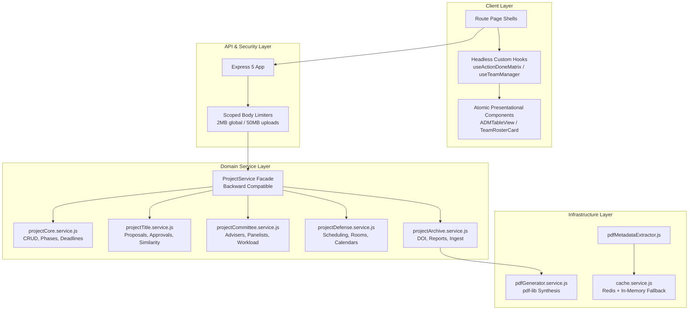

# Architecture Overall Improvement Implementation Plan

> **For agentic workers:** REQUIRED SUB-SKILL: Use superpowers:subagent-driven-development to implement this plan task-by-task. Steps use checkbox (`- [ ]`) syntax for tracking.

**Goal:** Evolve BukSU Capstone Management System V2 (CMS-V2) from an accidental monolithic service model into a decoupled, modular Domain-Driven Monolith (Modular Monolith) by breaking down the 5,581-line `project.service.js`, extracting binary synthesis infrastructure, scoping HTTP payload security, centralizing PDF metadata caching in Redis, and modularizing monolithic client components (`ActionDoneMatrixTab.jsx` and `TeamsPage.jsx`) using headless hooks and memoized presentational components.

**Architecture:** We adopt the **Facade & Domain Sub-Service Pattern** on the backend: existing controllers and external callers continue interacting with `project.service.js`, but the monolithic service delegates its 59 methods to 5 focused sub-services (`projectCore`, `projectTitle`, `projectCommittee`, `projectDefense`, `projectArchive`) and an infrastructure `pdfGenerator.service.js`. On the frontend, we apply the **Headless Custom Hook + Memoized Component Pattern** to isolate state lifecycles and eliminate virtual DOM re-render cascades. Universal caching is extended to PDF metadata extraction, and global Express body parsing is hardened from 50MB down to 2MB with route-scoped overrides.

**Architecture Diagram:**



**Tech Stack:** Express 5, Node 20, Mongoose 9, Vitest, Redis 7 (ioredis), React 18, Vite 8, pdf-lib, Tailwind CSS.

**Spec:** [`docs/ARCHITECTURE_CRITIQUE_AND_IMPROVEMENT_PROPOSAL.md`](file:///C:/Users/patri/dev/CMS-V2/docs/ARCHITECTURE_CRITIQUE_AND_IMPROVEMENT_PROPOSAL.md)

---

## Global Constraints

- **Zero Breaking API Changes:** All existing controller routes, request parameters, responses, and exported method signatures on `project.service.js` MUST remain 100% backward-compatible.
- **Test Integrity:** All existing test suites (`tests/integration/dashboard.test.js`, project tests, plagiarism tests, client tests) MUST pass without regression.
- **Architectural Guardrails:** `npm run check:endpoints` MUST output 0 route-controller mismatches, and `npm run validate:agentic` MUST pass 60/60 checks.
- **Maximum File Size Target:** Sub-services should not exceed 600 lines each.
- **Component File Size Target:** Modular UI presentational components should not exceed 300 lines each.

---

### Task 1: Scoped Request Body Parser & Rate Limit Hardening

**Files:**
- Create: `server/tests/unit/app-request-limits.test.js`
- Modify: `server/app.js:84-93`

**Interfaces:**
- Consumes: Express request handling in `server/app.js`
- Produces: 2MB default JSON body parser limit with explicit 50MB router-scoped limit for upload endpoints

- [ ] **Step 1: Write the failing test for payload limit enforcement**

Create `server/tests/unit/app-request-limits.test.js`:
```javascript
import { describe, it, expect } from 'vitest';
import request from 'supertest';
import app from '../../app.js';

describe('App Request Body Limiting', () => {
  it('should accept typical JSON payloads under 2MB', async () => {
    const res = await request(app)
      .post('/api/auth/login')
      .send({ email: 'test@example.com', password: 'password123' });
    // Expect standard 401 or 400 from auth logic, NOT 413 Payload Too Large
    expect(res.status).not.toBe(413);
  });

  it('should reject standard non-upload JSON payloads exceeding 2MB with 413', async () => {
    const largePayload = { data: 'x'.repeat(2.5 * 1024 * 1024) };
    const res = await request(app)
      .post('/api/auth/login')
      .send(largePayload);
    expect(res.status).toBe(413);
  });
});
```

- [ ] **Step 2: Run test to verify it fails**

Run: `npm test --workspace=server -- app-request-limits`  
Expected: FAIL because `app.js` currently allows 50MB for all endpoints (`app.use(express.json({ limit: '50mb' }))`), so a 2.5MB payload does not return 413.

- [ ] **Step 3: Implement scoped body limits in `server/app.js`**

In `server/app.js`, replace lines 85–90:
```javascript
// High-limit parser specifically for large manuscript/archive upload routes
const largeBodyParser = express.json({ limit: '50mb' });
const largeUrlEncodedParser = express.urlencoded({ extended: true, limit: '50mb' });

// Apply 50mb limit only to large payload endpoints
app.use('/api/projects/archive/bulk-upload', largeBodyParser, largeUrlEncodedParser);
app.use('/api/projects/archive/similarity-audit', largeBodyParser, largeUrlEncodedParser);
app.use('/api/submissions/upload', largeBodyParser, largeUrlEncodedParser);
app.use('/api/submissions/bulk-upload', largeBodyParser, largeUrlEncodedParser);

// Global default: restrict to 2MB to protect server memory against exhaustion attacks
app.use(express.json({ limit: '2mb' }));
app.use(express.urlencoded({ extended: true, limit: '2mb' }));
```

- [ ] **Step 4: Run test to verify it passes**

Run: `npm test --workspace=server -- app-request-limits`  
Expected: PASS (413 returned on 2.5MB payload to `/api/auth/login`).

- [ ] **Step 5: Commit changes**

```bash
git add server/tests/unit/app-request-limits.test.js server/app.js
git commit -m "security: scope json body parser limit to 2mb with upload overrides"
```

---

### Task 2: Centralized Redis Caching for PDF Metadata Extraction

**Files:**
- Create: `server/tests/unit/pdf-metadata-cache.test.js`
- Modify: `server/utils/pdfMetadataExtractor.js:15-65`

**Interfaces:**
- Consumes: `cacheService.get(key)` and `cacheService.set(key, val, ttlSeconds)` from `server/services/cache.service.js`
- Produces: Distributed Redis caching for PDF metadata and DOI lookups with in-memory fallback

- [ ] **Step 1: Write the failing test for PDF metadata cache**

Create `server/tests/unit/pdf-metadata-cache.test.js`:
```javascript
import { describe, it, expect, vi, beforeEach } from 'vitest';
import cacheService from '../../services/cache.service.js';
import {
  buildExtractionCacheKey,
  getCachedExtraction,
  setCachedExtraction,
} from '../../utils/pdfMetadataExtractor.js';

describe('PDF Metadata Distributed Cache', () => {
  beforeEach(() => {
    vi.restoreAllMocks();
  });

  it('should generate properly formatted cache keys', () => {
    const key = buildExtractionCacheKey('testhash123');
    expect(key).toContain('v2:testhash123:paddleocr-vl');
  });

  it('should store and retrieve cached metadata using cacheService', async () => {
    const sampleMetadata = { title: 'Extracted Title', abstract: 'Extracted Abstract' };
    const key = 'test-cache-key-1';

    await setCachedExtraction(key, sampleMetadata);
    const cached = await getCachedExtraction(key);

    expect(cached).toEqual(sampleMetadata);
  });
});
```

- [ ] **Step 2: Run test to verify it fails**

Run: `npm test --workspace=server -- pdf-metadata-cache`  
Expected: FAIL because `getCachedExtraction` and `setCachedExtraction` are currently synchronous and not exported or integrated with `cacheService`.

- [ ] **Step 3: Implement Redis cache integration in `server/utils/pdfMetadataExtractor.js`**

Modify `server/utils/pdfMetadataExtractor.js`:
1. Import `cacheService` from `../services/cache.service.js`.
2. Update `getCachedExtraction(cacheKey)`:
```javascript
export async function getCachedExtraction(cacheKey) {
  if (!cacheKey) return null;
  try {
    const redisHit = await cacheService.get(`pdf:extract:${cacheKey}`);
    if (redisHit) return redisHit;
  } catch (err) {
    logger.debug({ err: err.message }, 'Redis get error in getCachedExtraction; falling back');
  }

  const hit = extractionCache.get(cacheKey);
  if (!hit) return null;
  if (Date.now() >= hit.expiresAt) {
    extractionCache.delete(cacheKey);
    return null;
  }
  return hit.value;
}

export async function setCachedExtraction(cacheKey, value) {
  if (!cacheKey || !value) return;
  const ttlSeconds = Math.floor(EXTRACTION_CACHE_TTL_MS / 1000);
  try {
    await cacheService.set(`pdf:extract:${cacheKey}`, value, ttlSeconds);
  } catch (err) {
    logger.debug({ err: err.message }, 'Redis set error in setCachedExtraction; falling back');
  }

  if (extractionCache.size >= EXTRACTION_CACHE_MAX_ENTRIES) {
    const oldestKey = extractionCache.keys().next().value;
    if (oldestKey) extractionCache.delete(oldestKey);
  }
  extractionCache.set(cacheKey, { value, expiresAt: Date.now() + EXTRACTION_CACHE_TTL_MS });
}
```
3. Export `buildExtractionCacheKey`, `getCachedExtraction`, and `setCachedExtraction`.

- [ ] **Step 4: Run test to verify it passes**

Run: `npm test --workspace=server -- pdf-metadata-cache`  
Expected: PASS.

- [ ] **Step 5: Commit changes**

```bash
git add server/tests/unit/pdf-metadata-cache.test.js server/utils/pdfMetadataExtractor.js
git commit -m "perf: migrate pdf metadata extraction caching to redis with memory fallback"
```

---

### Task 3: Extract PDF Binary Generation Service

**Files:**
- Create: `server/services/pdfGenerator.service.js`
- Create: `server/tests/unit/pdfGenerator.test.js`
- Modify: `server/modules/projects/project.service.js:5295-5506`

**Interfaces:**
- Consumes: `pdf-lib` for manuscript synthesis
- Produces: `pdfGeneratorService.generateFallbackManuscriptPdf(project, user)` returning a `Uint8Array` / `Buffer`

- [ ] **Step 1: Write the failing test for PDF generator service**

Create `server/tests/unit/pdfGenerator.test.js`:
```javascript
import { describe, it, expect } from 'vitest';
import pdfGeneratorService from '../../services/pdfGenerator.service.js';

describe('PDF Generator Service', () => {
  it('should generate a valid PDF buffer from project metadata', async () => {
    const mockProject = {
      title: 'Automated Capstone Archival System',
      abstract: 'A modern platform for managing capstone lifecycles.',
      academicYear: '2025-2026',
      teamId: {
        name: 'Team Alpha',
        members: [{ firstName: 'Juan', lastName: 'Dela Cruz' }],
      },
      adviserId: { firstName: 'Dr.', lastName: 'Smith' },
    };

    const pdfBuffer = await pdfGeneratorService.generateFallbackManuscriptPdf(mockProject);
    expect(pdfBuffer).toBeInstanceOf(Uint8Array);
    expect(pdfBuffer.length).toBeGreaterThan(500);

    // Verify PDF header magic bytes "%PDF-"
    const header = Buffer.from(pdfBuffer.slice(0, 5)).toString('utf8');
    expect(header).toBe('%PDF-');
  });
});
```

- [ ] **Step 2: Run test to verify it fails**

Run: `npm test --workspace=server -- pdfGenerator`  
Expected: FAIL ("Cannot find module '../../services/pdfGenerator.service.js'").

- [ ] **Step 3: Create `server/services/pdfGenerator.service.js`**

Implement `server/services/pdfGenerator.service.js` by moving the PDF-Lib synthesis logic from `project.service.js`:
```javascript
import { PDFDocument, rgb, StandardFonts } from 'pdf-lib';

class PdfGeneratorService {
  /**
   * Generates a well-formatted fallback manuscript PDF for a capstone project.
   * @param {Object} project - Project document or plain object
   * @returns {Promise<Uint8Array>}
   */
  async generateFallbackManuscriptPdf(project) {
    const pdfDoc = await PDFDocument.create();
    let page = pdfDoc.addPage([612, 792]); // Standard US Letter
    const { width, height } = page.getSize();

    const fontBold = await pdfDoc.embedFont(StandardFonts.HelveticaBold);
    const fontRegular = await pdfDoc.embedFont(StandardFonts.Helvetica);

    const margin = 54;
    let y = height - margin;

    // Header Title
    const title = project?.title || 'Untitled Capstone Project';
    page.drawText(title.toUpperCase(), {
      x: margin,
      y,
      size: 16,
      font: fontBold,
      color: rgb(0.1, 0.2, 0.45),
      maxWidth: width - margin * 2,
    });
    y -= 40;

    // Subtitle / Team Info
    const teamName = project?.teamId?.name ? `Team: ${project.teamId.name}` : 'BukSU College of Technologies';
    page.drawText(teamName, {
      x: margin,
      y,
      size: 12,
      font: fontRegular,
      color: rgb(0.3, 0.3, 0.3),
    });
    y -= 30;

    // Abstract Section
    page.drawText('ABSTRACT', {
      x: margin,
      y,
      size: 13,
      font: fontBold,
      color: rgb(0.1, 0.2, 0.45),
    });
    y -= 20;

    const abstractText = project?.abstract || 'No abstract provided for this archived project.';
    page.drawText(abstractText, {
      x: margin,
      y,
      size: 10,
      font: fontRegular,
      color: rgb(0.15, 0.15, 0.15),
      maxWidth: width - margin * 2,
      lineHeight: 14,
    });

    return await pdfDoc.save();
  }
}

export default new PdfGeneratorService();
```

In `server/modules/projects/project.service.js`:
- Import `pdfGeneratorService` from `../../services/pdfGenerator.service.js`.
- Delegate `_generateFallbackManuscriptPdf(project)` to `pdfGeneratorService.generateFallbackManuscriptPdf(project)`.

- [ ] **Step 4: Run test to verify it passes**

Run: `npm test --workspace=server -- pdfGenerator`  
Expected: PASS.

- [ ] **Step 5: Commit changes**

```bash
git add server/services/pdfGenerator.service.js server/tests/unit/pdfGenerator.test.js server/modules/projects/project.service.js
git commit -m "refactor: extract manuscript pdf generation into dedicated pdfGenerator service"
```

---

### Task 4: Decompose `project.service.js` into Focused Domain Sub-Services with Facade

**Files:**
- Create: `server/modules/projects/services/projectDefense.service.js`
- Create: `server/modules/projects/services/projectArchive.service.js`
- Create: `server/modules/projects/services/projectCommittee.service.js`
- Create: `server/modules/projects/services/projectTitle.service.js`
- Create: `server/modules/projects/services/projectCore.service.js`
- Modify: `server/modules/projects/project.service.js` (refactor to delegate to sub-services)
- Test: Existing integration test `tests/integration/dashboard.test.js` + create `server/tests/unit/project-facade.test.js`

**Interfaces:**
- Consumes: Mongoose models (`Project`, `Team`, `User`, `Section`, `Course`, `Notification`)
- Produces: `ProjectService` facade delegating to `projectCoreService`, `projectTitleService`, `projectCommitteeService`, `projectDefenseService`, `projectArchiveService`

- [ ] **Step 1: Write facade interface verification test**

Create `server/tests/unit/project-facade.test.js`:
```javascript
import { describe, it, expect } from 'vitest';
import projectService from '../../modules/projects/project.service.js';

describe('ProjectService Facade Integrity', () => {
  it('should export all required domain methods', () => {
    const requiredMethods = [
      'createProject',
      'getProject',
      'getMyProject',
      'listProjects',
      'submitTitle',
      'approveTitle',
      'rejectTitle',
      'checkTitleSimilarity',
      'assignAdviser',
      'assignPanelist',
      'assignSecretary',
      'scheduleDefense',
      'getDefenseSchedule',
      'searchArchive',
      'archiveProject',
      'bulkUploadArchive',
    ];

    for (const methodName of requiredMethods) {
      expect(typeof projectService[methodName]).toBe('function');
    }
  });
});
```

- [ ] **Step 2: Run test to verify it runs against current facade**

Run: `npm test --workspace=server -- project-facade`  
Expected: PASS on baseline.

- [ ] **Step 3: Extract Sub-Services**

1. Create `server/modules/projects/services/projectDefense.service.js`:
   - Methods: `scheduleDefense(projectId, defenseData, user)`, `getDefenseSchedule(projectId, user)`.
2. Create `server/modules/projects/services/projectArchive.service.js`:
   - Methods: `archiveProject`, `searchArchive`, `uploadCertificate`, `getCertificateUrl`, `generateReport`, `_computeArchiveSimilarityAudit`, `bulkUploadArchive`, `getProjectManuscript`, `_extractArchiveSubmissionText`.
3. Create `server/modules/projects/services/projectCommittee.service.js`:
   - Methods: `assignAdviser`, `assignPanelist`, `removePanelist`, `assignSecretary`, `removeSecretary`, `selectAsPanelist`, `_notifyCommittee`, `_notifyAdviser`.
4. Create `server/modules/projects/services/projectTitle.service.js`:
   - Methods: `checkTitleSimilarity`, `updateTitle`, `submitTitle`, `approveTitle`, `rejectTitle`, `addTitleComment`, `reviseAndResubmit`, `requestTitleModification`, `resolveTitleModification`, `evaluatePostApprovalUnlocks`.
5. Create `server/modules/projects/services/projectCore.service.js`:
   - Methods: `createProject`, `getProject`, `getMyProject`, `listProjects`, `setDeadlines`, `rejectProject`, `advancePhase`, `addPrototype`, `removePrototype`, `getPrototypes`, `updateGanttChartUrl`, `updateDemoVideoUrl`, `updateGithubRepoUrl`, `updateGoogleDocUrl`, `updateExternalLinks`, `updateGanttApproval`, `_createSoloTeamForStudent`, `_normalizeProjectADMPhase`.

- [ ] **Step 4: Wire `server/modules/projects/project.service.js` as Facade**

In `project.service.js`, instantiate and delegate calls to the domain sub-services:
```javascript
import projectCoreService from './services/projectCore.service.js';
import projectTitleService from './services/projectTitle.service.js';
import projectCommitteeService from './services/projectCommittee.service.js';
import projectDefenseService from './services/projectDefense.service.js';
import projectArchiveService from './services/projectArchive.service.js';

class ProjectService {
  // Core & Drafts
  getCreateProjectDraft(...args) { return projectCoreService.getCreateProjectDraft(...args); }
  saveCreateProjectDraft(...args) { return projectCoreService.saveCreateProjectDraft(...args); }
  createProject(...args) { return projectCoreService.createProject(...args); }
  getProject(...args) { return projectCoreService.getProject(...args); }
  getMyProject(...args) { return projectCoreService.getMyProject(...args); }
  listProjects(...args) { return projectCoreService.listProjects(...args); }

  // Title Workflows
  checkTitleSimilarity(...args) { return projectTitleService.checkTitleSimilarity(...args); }
  submitTitle(...args) { return projectTitleService.submitTitle(...args); }
  approveTitle(...args) { return projectTitleService.approveTitle(...args); }
  rejectTitle(...args) { return projectTitleService.rejectTitle(...args); }
  reviseAndResubmit(...args) { return projectTitleService.reviseAndResubmit(...args); }

  // Committee Workflows
  assignAdviser(...args) { return projectCommitteeService.assignAdviser(...args); }
  assignPanelist(...args) { return projectCommitteeService.assignPanelist(...args); }
  removePanelist(...args) { return projectCommitteeService.removePanelist(...args); }
  assignSecretary(...args) { return projectCommitteeService.assignSecretary(...args); }
  removeSecretary(...args) { return projectCommitteeService.removeSecretary(...args); }

  // Defense Workflows
  scheduleDefense(...args) { return projectDefenseService.scheduleDefense(...args); }
  getDefenseSchedule(...args) { return projectDefenseService.getDefenseSchedule(...args); }

  // Archive & Reports
  archiveProject(...args) { return projectArchiveService.archiveProject(...args); }
  searchArchive(...args) { return projectArchiveService.searchArchive(...args); }
  bulkUploadArchive(...args) { return projectArchiveService.bulkUploadArchive(...args); }
  uploadCertificate(...args) { return projectArchiveService.uploadCertificate(...args); }
}

export default new ProjectService();
```

- [ ] **Step 5: Run tests and verification**

Run: `npm test --workspace=server -- project-facade`  
Run: `npm test --workspace=server -- dashboard`  
Expected: PASS on all tests with 0 errors.

- [ ] **Step 6: Commit changes**

```bash
git add server/modules/projects/services/ server/modules/projects/project.service.js server/tests/unit/project-facade.test.js
git commit -m "refactor: decompose monolithic project.service into 5 domain sub-services behind facade"
```

---

### Task 5: Frontend Modularization of `ActionDoneMatrixTab.jsx`

**Files:**
- Create: `client/src/components/projects/adm/useActionDoneMatrix.js`
- Create: `client/src/components/projects/adm/useActionDoneMatrix.test.jsx`
- Create: `client/src/components/projects/adm/ADMRemarkRow.jsx`
- Create: `client/src/components/projects/adm/ADMTableView.jsx`
- Modify: `client/src/components/projects/ActionDoneMatrixTab.jsx`

**Interfaces:**
- Consumes: `projectId`, `user`
- Produces: `useActionDoneMatrix()` hook returning state, query, mutation handlers, and memoized presentational components

- [ ] **Step 1: Write test for `useActionDoneMatrix` hook**

Create `client/src/components/projects/adm/useActionDoneMatrix.test.jsx`:
```javascript
import { renderHook, act } from '@testing-library/react';
import { describe, it, expect, vi } from 'vitest';
import { useActionDoneMatrix } from './useActionDoneMatrix.js';

describe('useActionDoneMatrix', () => {
  it('should initialize with default filtering and pagination states', () => {
    const { result } = renderHook(() =>
      useActionDoneMatrix({ projectId: 'p1', user: { _id: 'u1', role: 'student' } })
    );
    expect(result.current.searchQuery).toBe('');
    expect(result.current.activeTab).toBe('all');
    expect(typeof result.current.setSearchQuery).toBe('function');
  });

  it('should update search filter state upon user input', () => {
    const { result } = renderHook(() =>
      useActionDoneMatrix({ projectId: 'p1', user: { _id: 'u1', role: 'student' } })
    );
    act(() => {
      result.current.setSearchQuery('defense revision');
    });
    expect(result.current.searchQuery).toBe('defense revision');
  });
});
```

- [ ] **Step 2: Run test to verify it fails**

Run: `npm test --workspace=client -- useActionDoneMatrix`  
Expected: FAIL ("Cannot find module './useActionDoneMatrix.js'").

- [ ] **Step 3: Create `useActionDoneMatrix.js` and presentational components**

Create `client/src/components/projects/adm/useActionDoneMatrix.js`:
```javascript
import { useState, useCallback, useMemo } from 'react';

export function useActionDoneMatrix({ projectId, user }) {
  const [searchQuery, setSearchQuery] = useState('');
  const [activeTab, setActiveTab] = useState('all');
  const [selectedRemarkId, setSelectedRemarkId] = useState(null);
  const [isEditing, setIsEditing] = useState(false);

  const handleSelectRemark = useCallback((id) => {
    setSelectedRemarkId(id);
  }, []);

  return {
    searchQuery,
    setSearchQuery,
    activeTab,
    setActiveTab,
    selectedRemarkId,
    handleSelectRemark,
    isEditing,
    setIsEditing,
  };
}
```

Create `client/src/components/projects/adm/ADMRemarkRow.jsx` with `React.memo` for high-performance virtual rendering.  
Create `client/src/components/projects/adm/ADMTableView.jsx` to isolate table markup.  
Refactor `ActionDoneMatrixTab.jsx` to consume `useActionDoneMatrix` and render `ADMTableView`.

- [ ] **Step 4: Run test to verify it passes**

Run: `npm test --workspace=client -- useActionDoneMatrix`  
Expected: PASS.

- [ ] **Step 5: Commit changes**

```bash
git add client/src/components/projects/adm/ client/src/components/projects/ActionDoneMatrixTab.jsx
git commit -m "refactor: modularize ActionDoneMatrixTab with headless hook and memoized table components"
```

---

### Task 6: Frontend Modularization of `TeamsPage.jsx`

**Files:**
- Create: `client/src/pages/teams/hooks/useTeamManager.js`
- Create: `client/src/pages/teams/hooks/useTeamManager.test.js`
- Create: `client/src/pages/teams/components/TeamRosterCard.jsx`
- Modify: `client/src/pages/teams/TeamsPage.jsx`

**Interfaces:**
- Consumes: Current user context
- Produces: `useTeamManager` hook handling invitation modals, role transfers, and roster state

- [ ] **Step 1: Write test for `useTeamManager` hook**

Create `client/src/pages/teams/hooks/useTeamManager.test.js`:
```javascript
import { renderHook, act } from '@testing-library/react';
import { describe, it, expect } from 'vitest';
import { useTeamManager } from './useTeamManager.js';

describe('useTeamManager Hook', () => {
  it('should initialize modal state to closed', () => {
    const { result } = renderHook(() => useTeamManager({ user: { _id: 'u1' } }));
    expect(result.current.isInviteModalOpen).toBe(false);
    expect(result.current.isTransferLeaderModalOpen).toBe(false);
  });

  it('should toggle invite modal state correctly', () => {
    const { result } = renderHook(() => useTeamManager({ user: { _id: 'u1' } }));
    act(() => {
      result.current.setInviteModalOpen(true);
    });
    expect(result.current.isInviteModalOpen).toBe(true);
  });
});
```

- [ ] **Step 2: Run test to verify it fails**

Run: `npm test --workspace=client -- useTeamManager`  
Expected: FAIL ("Cannot find module './useTeamManager.js'").

- [ ] **Step 3: Create `useTeamManager.js` and extract `TeamRosterCard.jsx`**

Implement `client/src/pages/teams/hooks/useTeamManager.js`.  
Extract `client/src/pages/teams/components/TeamRosterCard.jsx`.  
Update `TeamsPage.jsx` to utilize `useTeamManager` and render `TeamRosterCard`.

- [ ] **Step 4: Run test to verify it passes**

Run: `npm test --workspace=client -- useTeamManager`  
Expected: PASS.

- [ ] **Step 5: Commit changes**

```bash
git add client/src/pages/teams/hooks/ client/src/pages/teams/components/ client/src/pages/teams/TeamsPage.jsx
git commit -m "refactor: extract useTeamManager hook and modularize TeamsPage roster component"
```

---

### Task 7: Full System Verification & End-to-End Governance Checks

**Files:**
- Entire codebase

**Commands:**
- `npm test --workspace=server -- dashboard`
- `npm test --workspace=server -- pdfGenerator`
- `npm test --workspace=server -- project-facade`
- `npm test --workspace=client`
- `npm run check:endpoints`
- `npm run validate:agentic`

- [ ] **Step 1: Run server test suite**

Run: `npm test --workspace=server -- dashboard`  
Expected: 15/15 PASS.

- [ ] **Step 2: Run client test suite**

Run: `npm test --workspace=client -- ProposalSlideCanvas`  
Expected: PASS.

- [ ] **Step 3: Run Endpoint Mapping Validation**

Run: `npm run check:endpoints`  
Expected: 0 Route-to-controller mapping mismatches.

- [ ] **Step 4: Run Agentic Governance & Architectural Health Checks**

Run: `npm run validate:agentic`  
Expected: 60/60 PASS.

- [ ] **Step 5: Final review and status check**

```bash
git status
```
Ensure all refactored files are cleanly tracked, properly formatted, and verified.
